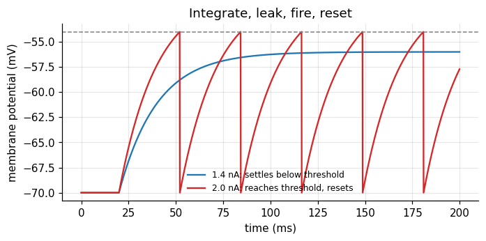
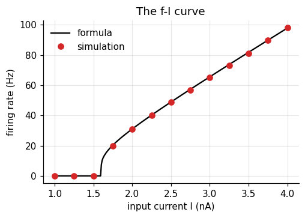
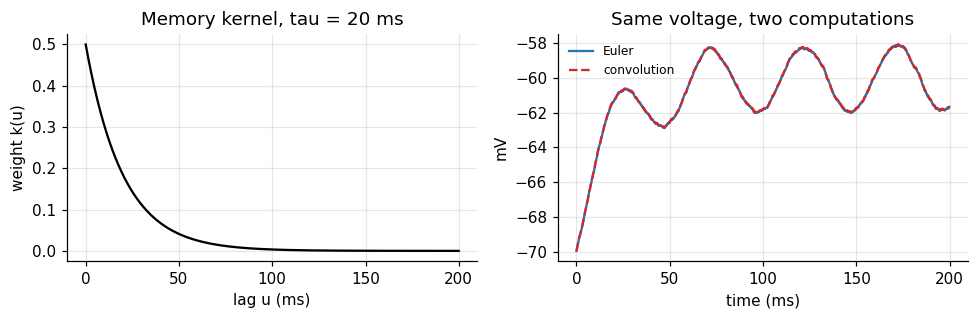
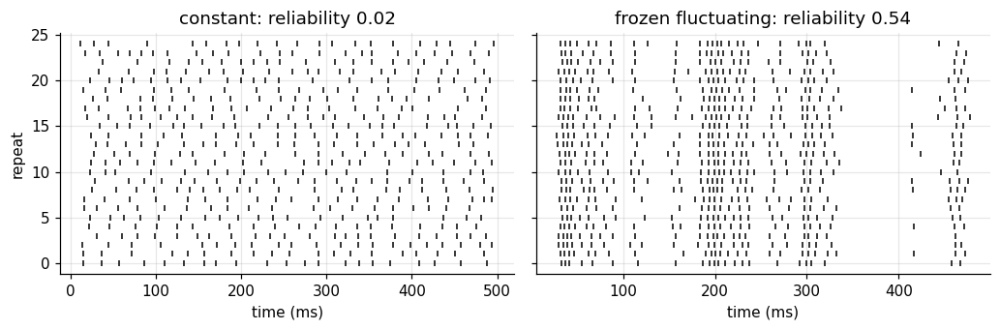
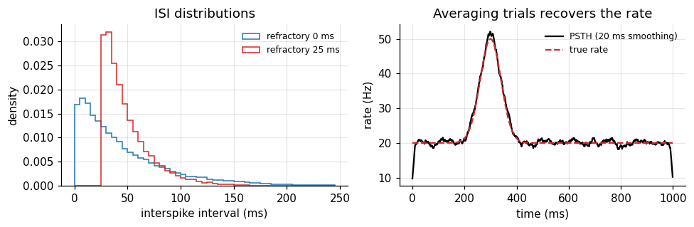
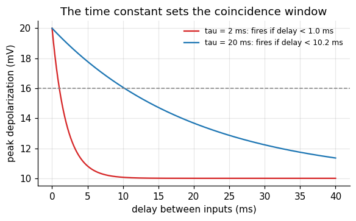
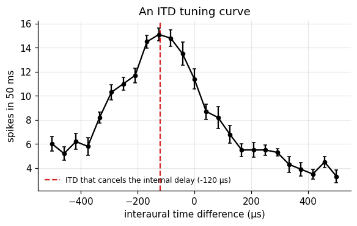
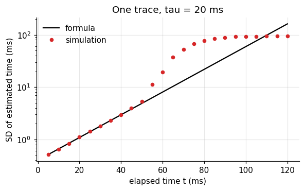
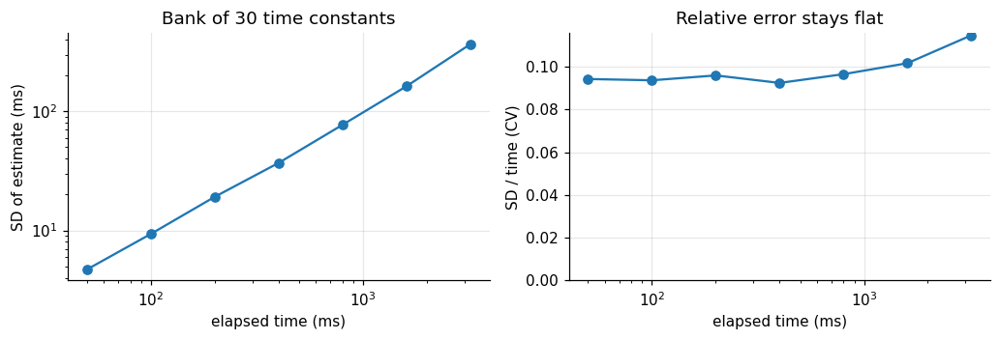
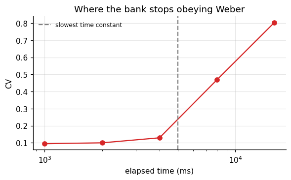

Timing in the brain spans six orders of magnitude. A barn owl locates a mouse by sound arrival
differences of a few microseconds. A person reproduces an interval of a second. A typical neuron
forgets its input within some tens of milliseconds. Which of these timing problems can one neuron
solve on its own, and which need more?

**Part I · Foundations** builds the standard model neuron from its equation: integration, threshold,
noise, spike statistics, and the difference between an integrator and a coincidence detector.

**Part II · Case study** asks the timing question in six stages:

| stage | question |
|---|---|
| 1. Cognitive phenomenon | What needs explaining? |
| 2. Behavioral experiment | How do we make it measurable? |
| 3. Empirical signature | What pattern in the data is the phenomenon? |
| 4. Computational model | What computation produces it, and can we identify it? |
| 5. Neural implementation | Could neurons carry it out? |
| 6. Prediction and failure | Which result would prove the model wrong? |

All neurons here are simulated, so every estimate can be checked against the truth.

```python
import numpy as np
import matplotlib.pyplot as plt
from scipy.ndimage import gaussian_filter1d
from scipy.optimize import curve_fit

plt.rcParams.update({
    "figure.dpi": 110, "axes.spines.top": False, "axes.spines.right": False,
    "axes.grid": True, "grid.alpha": 0.3, "font.size": 10,
})
rng = np.random.default_rng(0)
```

## 1. The leaky integrate-and-fire neuron

A neuron's membrane is a leaky bucket of charge. Input current fills it; a leak drains it back to
rest. When the voltage reaches a threshold, the neuron fires a spike and the voltage is reset. This
is the leaky integrate-and-fire (LIF) model, which goes back to Lapicque (1907).

$$\tau \frac{d\mu}{dt} = -(\mu - \mu_0) + R\,I(t), \qquad \text{spike and reset when } \mu \ge \theta.$$

| symbol | meaning | value here |
|---|---|---|
| \(\mu\) | membrane potential: how charged the bucket is | mV |
| \(\mu_0\) | resting potential: where the leak pulls the voltage | \(-70\) mV |
| \(I(t)\) | input current from synapses or an electrode | nA |
| \(R\) | membrane resistance: how much voltage one unit of current produces | 10 M\(\Omega\) |
| \(\tau = RC\) | membrane time constant: how long the bucket remembers | 20 ms |
| \(\theta\) | spike threshold | \(-54\) mV |

The time constant \(\tau\) is the central quantity of this tutorial. It is the neuron's memory span.

### Euler steps

A computer advances the equation in small steps of size \(\Delta t\):

$$\mu_{t+1} = \mu_t + \frac{\Delta t}{\tau}\big(-(\mu_t - \mu_0) + R\,I_t\big).$$

For a constant input there is also a closed form, which lets us check the steps:
\(\mu(t) = \mu_\infty + (\mu_0 - \mu_\infty)e^{-t/\tau}\) with \(\mu_\infty = \mu_0 + RI\).

```python
tau, R, mu0, theta, mu_reset = 20.0, 10.0, -70.0, -54.0, -70.0   # ms, MOhm, mV, mV, mV
dt = 0.1                                                         # ms
t = np.arange(0, 200, dt)                                        # (T,) time axis


def lif(I, tau=tau, noise=0.0, rng=rng, spikes=True):
    # I: (n, T) input currents for n neurons or trials. Returns voltage (n, T) and spike mask (n, T).
    I = np.atleast_2d(I)
    n, T = I.shape
    mu = np.full(n, mu0)
    V = np.empty((n, T)); S = np.zeros((n, T), bool)
    for k in range(T):
        mu = mu + dt / tau * (-(mu - mu0) + R * I[:, k]) + noise * np.sqrt(dt) * rng.normal(size=n)
        if spikes:
            fired = mu >= theta
            S[fired, k] = True
            mu[fired] = mu_reset
        V[:, k] = mu
    return V, S


I_step = np.where(t >= 20, 1.4, 0.0)                              # (T,) step of 1.4 nA, below threshold
V, _ = lif(I_step, spikes=False)                                  # (1, T)
closed = np.where(t >= 20, mu0 + R * 1.4 * (1 - np.exp(-(t - 20) / tau)), mu0)
print(f"largest difference Euler vs closed form: {np.abs(V[0] - closed).max():.3f} mV")

I_supra = np.where(t >= 20, 2.0, 0.0)                             # 2.0 nA, above threshold
V2, S2 = lif(I_supra)
fig, ax = plt.subplots(figsize=(7, 3))
ax.plot(t, V[0], color="C0", label="1.4 nA: settles below threshold")
ax.plot(t, V2[0], color="C3", label="2.0 nA: reaches threshold, resets")
ax.axhline(theta, color="0.5", ls="--", lw=1)
ax.set(xlabel="time (ms)", ylabel="membrane potential (mV)", title="Integrate, leak, fire, reset")
ax.legend(frameon=False, fontsize=8)
plt.show()
```

```text
largest difference Euler vs closed form: 0.070 mV
```



## 2. From input to firing rate: the f-I curve

With a constant input above threshold, the neuron fires regularly. The time from reset to threshold
follows from the closed form. Solving \(\mu(T) = \theta\) gives the interspike interval, and its
inverse is the rate:

$$f(I) = \left[t_\text{ref} + \tau \ln \frac{RI}{RI - (\theta - \mu_0)}\right]^{-1} \quad \text{for } RI > \theta - \mu_0, \text{ else } 0.$$

Here \(t_\text{ref}\) is a refractory period after each spike; our simulation has none, so
\(t_\text{ref} = 0\). Below the threshold current \((\theta - \mu_0)/R = 1.6\) nA the rate is exactly zero.

```python
I_levels = np.linspace(1.0, 4.0, 13)                              # (L,) constant input levels
t_long = np.arange(0, 1000, dt)                                   # 1 s of simulation
_, S = lif(np.repeat(I_levels[:, None], t_long.size, axis=1))     # (L, T) spikes
rate_sim = S.sum(axis=1) / 1.0                                    # (L,) spikes per second

I_fine = np.linspace(1.0, 4.0, 300)
drive = R * I_fine
rate_formula = np.where(drive > theta - mu0,
                        1000 / (tau * np.log(drive / np.maximum(drive - (theta - mu0), 1e-9))), 0)

fig, ax = plt.subplots(figsize=(5, 3.2))
ax.plot(I_fine, rate_formula, color="k", label="formula")
ax.plot(I_levels, rate_sim, "o", color="C3", label="simulation")
ax.set(xlabel="input current I (nA)", ylabel="firing rate (Hz)", title="The f-I curve")
ax.legend(frameon=False)
plt.show()
```



The curve has a hard threshold and then rises roughly linearly. That shape, zero then rising, is the
"nonlinearity" that appears in almost every rate model.

## 3. The neuron as a linear filter

Below threshold the LIF equation is linear. Then the voltage is the input convolved with a fixed
kernel:

$$\mu(t) - \mu_0 = \int_0^\infty k(u)\, I(t-u)\, du, \qquad k(u) = \frac{R}{\tau} e^{-u/\tau}.$$

The kernel says how much an input \(u\) milliseconds ago still counts now. It halves every
\(\tau \ln 2 \approx 14\) ms. In code the convolution is `np.convolve(I, k)[:T] * dt`, shape (T,).

```python
I_wiggle = 1.0 + 0.5 * np.sin(2 * np.pi * t / 50) + 0.3 * rng.normal(size=t.size)   # (T,) arbitrary input
V_euler, _ = lif(I_wiggle, spikes=False)                          # (1, T)
k = (R / tau) * np.exp(-t / tau)                                  # (T,) the kernel
V_conv = mu0 + np.convolve(I_wiggle, k)[: t.size] * dt            # (T,)
print(f"largest difference Euler vs convolution: {np.abs(V_euler[0] - V_conv).max():.3f} mV")

fig, axes = plt.subplots(1, 2, figsize=(9, 3))
axes[0].plot(t, k, color="k")
axes[0].set(xlabel="lag u (ms)", ylabel="weight k(u)", title="Memory kernel, tau = 20 ms")
axes[1].plot(t, V_euler[0], color="C0", label="Euler")
axes[1].plot(t, V_conv, color="C3", ls="--", label="convolution")
axes[1].set(xlabel="time (ms)", ylabel="mV", title="Same voltage, two computations")
axes[1].legend(frameon=False, fontsize=8)
plt.tight_layout()
plt.show()
```

```text
largest difference Euler vs convolution: 0.027 mV
```



The small difference comes from the Euler step, not from the theory. This view matters for timing:
whatever the neuron "knows" about the past is a weighted sum with weights that decay as
\(e^{-u/\tau}\). After a few \(\tau\), the past is gone.

## 4. Noise and reliability

Real neurons are noisy. Add a fluctuating term to the equation and ask a simple question: if the
same input is given twice, do the spikes come at the same times? Mainen and Sejnowski (1995) did
this in cortical slices. With a constant current the spike times drifted apart across repeats.
With a fluctuating current, repeated identically ("frozen noise"), the spikes lined up.

We repeat their logic. Both inputs have the same mean. Each repeat adds fresh internal noise.

```python
n_rep = 25
t_rel = np.arange(0, 500, dt)
z = gaussian_filter1d(rng.normal(size=t_rel.size), 5 / dt)       # (T,) noise smoothed over about 5 ms
frozen = 2.2 + 2.0 * z / z.std()                                  # (T,) same mean as the constant input
inputs = {"constant": np.full(t_rel.size, 2.2), "frozen fluctuating": frozen}


def reliability(S, smooth_ms=2.0):
    # Mean correlation between repeats after smoothing each spike train: 0 = unrelated, 1 = identical
    g = gaussian_filter1d(S.astype(float), smooth_ms / dt, axis=1)   # (n_rep, T)
    g -= g.mean(axis=1, keepdims=True)
    g /= np.linalg.norm(g, axis=1, keepdims=True)
    C = g @ g.T                                                   # (n_rep, n_rep)
    return (C.sum() - n_rep) / (n_rep ** 2 - n_rep)


fig, axes = plt.subplots(1, 2, figsize=(9.5, 3.2), sharey=True)
for ax, (name, I) in zip(axes, inputs.items()):
    _, S = lif(np.tile(I, (n_rep, 1)), noise=1.0)                 # (n_rep, T) fresh internal noise each repeat
    for r in range(n_rep):
        ax.plot(t_rel[S[r]], np.full(S[r].sum(), r), "|", color="k", ms=4)
    ax.set(xlabel="time (ms)", title=f"{name}: reliability {reliability(S):.2f}")
    print(f"{name:20s} spikes per repeat {S.sum(axis=1).mean():.1f}, reliability {reliability(S):.2f}")
axes[0].set_ylabel("repeat")
plt.tight_layout()
plt.show()
```

```text
constant             spikes per repeat 20.3, reliability 0.02
frozen fluctuating   spikes per repeat 25.1, reliability 0.54
```



Reliability here is the average correlation between repeats after smoothing each spike train by
2 ms. Under constant input the spike times drift apart: each interval adds its own error, and after
a few spikes the repeats are unrelated. Under a fluctuating input many spikes stay locked to the
input's upswings, although both neurons fire about as often. The neuron itself is
reliable; whether its output looks noisy depends on what it is given. A spike train that looks
irregular is therefore not proof that timing carries no information.

## 5. Poisson spikes, Fano factor, and ISIs

Many analyses treat spikes as a Poisson process: in each small bin a spike occurs with probability
\(r\,\Delta t\), independently of everything else. Two signatures follow:

| quantity | definition | Poisson value |
|---|---|---|
| Fano factor | \(\mathrm{Var}(\text{count}) / \mathrm{E}(\text{count})\) | 1 |
| ISI distribution | histogram of interspike intervals | exponential, CV = 1 |

Cortical neurons in vivo often come close to these values (Tolhurst, Movshon & Dean, 1983;
Softky & Koch, 1993). A refractory period breaks them: very short intervals become impossible, and
the train becomes more regular than Poisson.

```python
rate, T_s, n_trials = 20.0, 1.0, 2000                             # Hz, s, trials
dt_s = 1e-3
bins = int(T_s / dt_s)


def poisson_trains(rate, refractory_ms=0.0):
    spk = rng.random((n_trials, bins)) < rate * dt_s              # (trials, bins)
    if refractory_ms > 0:                                         # delete spikes inside the dead time
        dead = int(refractory_ms / 1000 / dt_s)
        for tr in range(n_trials):
            idx = np.flatnonzero(spk[tr]); last = -10**9
            for i in idx:
                if i - last <= dead:
                    spk[tr, i] = False
                else:
                    last = i
    return spk


fig, axes = plt.subplots(1, 2, figsize=(9, 3))
for refr, col in [(0, "C0"), (25, "C3")]:
    spk = poisson_trains(rate if refr == 0 else rate / (1 - rate * refr / 1000), refr)
    counts = spk.sum(axis=1)                                      # (trials,)
    isi = np.concatenate([np.diff(np.flatnonzero(s)) for s in spk]) * dt_s * 1000   # ms
    fano = counts.var() / counts.mean()
    cv = isi.std() / isi.mean()
    print(f"refractory {refr:2d} ms: mean count {counts.mean():.1f}, Fano {fano:.2f}, ISI CV {cv:.2f}")
    axes[0].hist(isi, bins=np.arange(0, 250, 5), density=True, histtype="step", color=col, lw=1.5,
                 label=f"refractory {refr} ms")
axes[0].set(xlabel="interspike interval (ms)", ylabel="density", title="ISI distributions")
axes[0].legend(frameon=False, fontsize=8)

# A PSTH: average many trials of a time-varying rate
r_t = 20 + 30 * np.exp(-0.5 * ((np.arange(bins) - 300) / 40) ** 2)   # (bins,) Hz
spk = rng.random((n_trials, bins)) < r_t * dt_s
psth = spk.mean(axis=0) / dt_s                                    # (bins,) Hz
axes[1].plot(np.arange(bins), np.convolve(psth, np.ones(20) / 20, "same"), color="k", label="PSTH (20 ms smoothing)")
axes[1].plot(np.arange(bins), r_t, color="C3", ls="--", label="true rate")
axes[1].set(xlabel="time (ms)", ylabel="rate (Hz)", title="Averaging trials recovers the rate")
axes[1].legend(frameon=False, fontsize=8)
plt.tight_layout()
plt.show()
```

```text
refractory  0 ms: mean count 20.1, Fano 1.05, ISI CV 0.98
refractory 25 ms: mean count 20.1, Fano 0.24, ISI CV 0.48
```



The pure Poisson train has Fano factor and CV near 1. A 25 ms dead time pulls both down. The
peristimulus time histogram (PSTH) shows the other use of averaging: the rate that a single trial
hides becomes visible over many.

The Poisson description is a **rate code**: only the expected number of spikes in a window
matters. Section 4 showed that real spike *times* can be precise. Which description is right
depends on the input and on the reader downstream, and the next section makes that concrete.

## 6. Integrator or coincidence detector?

Give a neuron two input pulses separated by a delay \(\Delta\). Each pulse raises the voltage by
\(A\), which then decays with \(\tau\). The peak after the second pulse is

$$\mu_\text{peak} - \mu_0 = A\left(1 + e^{-\Delta/\tau}\right).$$

If one pulse alone stays below threshold but two simultaneous pulses cross it, the neuron fires
only when \(\Delta\) is small enough: \(\Delta < \tau \ln \frac{A}{(\theta - \mu_0) - A}\).
The size of that window is set by \(\tau\).

- A **long** \(\tau\) makes an **integrator**: inputs far apart in time still add up.
- A **short** \(\tau\) makes a **coincidence detector**: only nearly simultaneous inputs count.

(König, Engel & Singer, 1996.) Cortical neurons in vivo sit between the two. Strong balanced
excitation and inhibition shortens their effective time constant (Shadlen & Newsome, 1998).

```python
A = 10.0                                                          # mV per input pulse; threshold is 16 mV above rest
delays = np.linspace(0, 40, 401)                                  # (D,) ms between the two pulses
fig, ax = plt.subplots(figsize=(6, 3.2))
for tau_k, col in [(2.0, "C3"), (20.0, "C0")]:
    peak = A * (1 + np.exp(-delays / tau_k))                      # (D,) depolarization after pulse 2
    window = tau_k * np.log(A / ((theta - mu0) - A))
    ax.plot(delays, peak, color=col, label=f"tau = {tau_k:g} ms: fires if delay < {window:.1f} ms")
ax.axhline(theta - mu0, color="0.5", ls="--", lw=1)
ax.set(xlabel="delay between inputs (ms)", ylabel="peak depolarization (mV)",
       title="The time constant sets the coincidence window")
ax.legend(frameon=False, fontsize=8)
plt.show()
```



### What Part I gives us

- The LIF equation, solved by Euler steps and checked against the closed form.
- The f-I curve: a threshold, then a roughly linear rise.
- Below threshold, the neuron is a linear filter with an exponential memory of length \(\tau\).
- Spike timing can be precise; irregular output may reflect irregular input.
- Poisson spikes have Fano factor and ISI CV near 1; refractoriness lowers both.
- The same time constant decides between integration and coincidence detection.

# Part II · Case study: can a single neuron tell time?

## Stage 1 · Cognitive phenomenon

Two timing abilities look unrelated.

- **Microseconds.** Barn owls turn their head toward a sound with an accuracy that requires
  telling apart interaural time differences (ITDs) of a few microseconds. Neurons in the owl's
  nucleus laminaris fire most for one particular ITD (Carr & Konishi, 1990).
- **Hundreds of milliseconds to seconds.** Humans and animals reproduce intervals with errors that
  grow in proportion to the interval: the scalar property, Weber's law for time (Gibbon, 1977).

The question: which of these can be explained by the time constant of a single neuron? Section 6
suggests an answer for the first. Section 3 suggests a problem for the second: a single neuron
forgets within a few \(\tau\).

## Stage 2 · Behavioral experiment

We pose both problems to model neurons, the way an electrophysiologist would.

- **ITD experiment.** A 500 Hz tone reaches the two ears with a time difference. Each ear sends four
  input fibers, each firing on about half of the tone's cycles, locked to its phase with 60 μs of
  timing jitter. A detector neuron with a 200 μs time constant receives both ears, and the left
  input passes an internal axonal delay of 120 μs. We play
  25 ITDs between \(-500\) and \(+500\) μs and count its spikes.
- **Interval experiment.** A brief pulse starts the interval. At a later time \(t\) we read out the
  neuron's state and ask how well \(t\) can be recovered from it.

```python
# ITD experiment: microsecond resolution needs a microsecond time step
dt_us = 5.0                                                       # μs
dur_us = 50_000                                                   # 50 ms of tone
t_us = np.arange(0, dur_us, dt_us)                                # (T,)
f_tone = 500.0                                                    # Hz
period_us = 1e6 / f_tone
jitter_us = 60.0
n_fibers = 4                                                      # input fibers per ear
true_delay = 120.0                                                # μs: internal delay on the left input
itds = np.linspace(-500, 500, 25)                                 # (n_itd,) μs, positive = left ear later


def ear_spikes(offset_us, n):
    # One fiber: a spike per cycle with probability 0.5, at the tone's phase plus jitter. (n, T) bool.
    cycles = np.arange(0, dur_us, period_us)
    S = np.zeros((n, t_us.size), bool)
    for i in range(n):
        keep = rng.random(cycles.size) < 0.5
        times = cycles[keep] + offset_us + rng.normal(0, jitter_us, keep.sum())
        idx = np.round(times / dt_us).astype(int)
        S[i, idx[(idx >= 0) & (idx < t_us.size)]] = True
    return S


def detector_counts(itd_list, n_rep, tau_us=200.0, w=5.0, thr=14.0):
    # Coincidence detector: leaky sum of both ears' input, spike above thr, reset to 0.
    counts = np.zeros((len(itd_list), n_rep))
    for a, itd in enumerate(itd_list):
        left = sum(ear_spikes(itd + true_delay, n_rep).astype(float) for _ in range(n_fibers))
        right = sum(ear_spikes(0.0, n_rep).astype(float) for _ in range(n_fibers))
        drive = (left + right) * w                                # (n_rep, T) mV jumps
        v = np.zeros(n_rep); c = np.zeros(n_rep)
        decay = np.exp(-dt_us / tau_us)
        for k in range(t_us.size):
            v = v * decay + drive[:, k]
            fired = v >= thr
            c += fired; v[fired] = 0.0
        counts[a] = c
    return counts                                                 # (n_itd, n_rep)


itd_counts = detector_counts(itds, n_rep=10)
print("spike counts:", itd_counts.shape, " mean per ITD:", itd_counts.mean(axis=1).round(1)[::4])
```

```text
spike counts: (25, 10)  mean per ITD: [ 6.   8.2 14.5 11.4  5.5  4.3  3.3]
```

## Stage 3 · Empirical signature

For the ITD experiment, the signature is a **tuning curve**: spike count against ITD. For the
interval experiment, it is **timing error against elapsed time**. We look at the first now and
the second after building the model.

```python
mean_c = itd_counts.mean(axis=1); se_c = itd_counts.std(axis=1) / np.sqrt(itd_counts.shape[1])
fig, ax = plt.subplots(figsize=(6, 3.3))
ax.errorbar(itds, mean_c, yerr=se_c, fmt="o-", color="k", capsize=2, ms=4)
ax.axvline(-true_delay, color="C3", ls="--", label=f"ITD that cancels the internal delay ({-true_delay:g} μs)")
ax.set(xlabel="interaural time difference (μs)", ylabel="spikes in 50 ms", title="An ITD tuning curve")
ax.legend(frameon=False, fontsize=8)
plt.show()
```



The detector fires most when the ITD cancels its internal delay: then the two ears' spikes arrive
together. This is Jeffress's (1948) proposal: a row of detectors with different internal delays
turns a *time* difference into a *place* in the row, which is also a place in auditory space.

## Stage 4 · Computational model

### Coincidence: recovering the preferred ITD

The detector computes something like a product of its two inputs over a short window. Near its
peak, the tuning curve is well described by a baseline plus a bump centered on the ITD that
cancels the internal delay:

$$c(\text{ITD}) = b + g\,\exp\!\left(-\frac{(\text{ITD} - \text{ITD}^*)^2}{2w^2}\right).$$

| symbol | meaning |
|---|---|
| \(b\) | firing from chance coincidences |
| \(g\) | extra firing when the ears line up |
| \(\text{ITD}^*\) | preferred ITD: minus the internal delay |
| \(w\) | tuning width, set by input jitter and the time constant |

Can we recover \(\text{ITD}^*\) from spike counts? Parameter recovery: fit the curve to many small
simulated experiments and look at the spread of the estimates.

```python
def tuning(itd, b, g, itd_star, w):
    return b + g * np.exp(-0.5 * ((itd - itd_star) / w) ** 2)


p, _ = curve_fit(tuning, np.repeat(itds, itd_counts.shape[1]), itd_counts.ravel(), p0=[3, 8, 0, 200])
print(f"estimated preferred ITD {p[2]:.1f} μs (truth {-true_delay:.1f} μs), width {abs(p[3]):.0f} μs")

est = []
for rep in range(8):
    c_rep = detector_counts(itds, n_rep=3)                        # small experiments: 3 tones per ITD
    pp, _ = curve_fit(tuning, np.repeat(itds, 3), c_rep.ravel(), p0=[3, 8, 0, 200])
    est.append(pp[2])
est = np.array(est)
print(f"8 small experiments: mean {est.mean():.1f} μs, SD {est.std():.1f} μs")
```

```text
estimated preferred ITD -122.8 μs (truth -120.0 μs), width 143 μs
```

```text
8 small experiments: mean -111.3 μs, SD 10.8 μs
```

With only three 50 ms tones per ITD, the preferred ITD is recovered to about ten microseconds,
with a small bias toward zero that comes from fitting a symmetric bump to a curve that is not
perfectly symmetric. The input jitter is 60 μs and the time constant is 200 μs, yet the averaged
coincidences resolve much finer differences. A single neuron with a short time constant can
compare arrival times at microsecond scale.

### Elapsed time: what a decaying trace can tell

Now the second problem. After a pulse at time 0, the neuron's state decays:
\(x(t) = A e^{-t/\tau}\). A reader sees \(x\) plus noise of size \(\sigma\) and must infer \(t\). Invert the
decay: \(\hat t = -\tau \ln(x/A)\). A small error \(\delta x\) in \(x\) becomes an error in time of
\(\delta t = \delta x / |dx/dt|\), so

$$\mathrm{SD}(\hat t) \approx \frac{\sigma}{|dx/dt|} = \frac{\sigma\,\tau}{A}\, e^{t/\tau}.$$

The error grows **exponentially** with elapsed time. Check by simulation:

```python
A_tr, sigma_tr = 1.0, 0.02                                        # trace amplitude, readout noise
t_probe = np.linspace(5, 120, 24)                                 # (P,) ms
n_sim = 4000
x_obs = A_tr * np.exp(-t_probe[:, None] / tau) + sigma_tr * rng.normal(size=(t_probe.size, n_sim))   # (P, n)
t_hat = -tau * np.log(np.clip(x_obs, 1e-6, None) / A_tr)          # (P, n)
sd_sim = t_hat.std(axis=1)                                        # (P,)
sd_formula = sigma_tr * tau / A_tr * np.exp(t_probe / tau)        # (P,)

fig, ax = plt.subplots(figsize=(6, 3.3))
ax.plot(t_probe, sd_formula, color="k", label="formula")
ax.plot(t_probe, sd_sim, "o", color="C3", ms=4, label="simulation")
ax.set(xlabel="elapsed time t (ms)", ylabel="SD of estimated time (ms)", yscale="log",
       title=f"One trace, tau = {tau:g} ms")
ax.legend(frameon=False)
plt.show()
print("SD at 20, 60, 100 ms:", np.interp([20, 60, 100], t_probe, sd_sim).round(1), "ms")
```



```text
SD at 20, 60, 100 ms: [ 1.1 19.4 92.9] ms
```

Simulation and formula agree until the trace sinks into the noise; then the estimate saturates
because the information is simply gone. For a 20 ms membrane, elapsed time is readable for a few
tens of milliseconds. Even a slow synaptic process with \(\tau = 100\) ms only moves the cliff.

| claim | status |
|---|---|
| A single neuron can compare arrival times at microsecond scale. | **consistent with** the owl data and **implementable** (this simulation) |
| A single decaying trace can time intervals of a second. | rejected by the formula: the error grows as \(e^{t/\tau}\) |

## Stage 5 · Neural implementation

If one time constant is not enough, use many. Suppose a pulse starts decaying traces in a bank of
neurons whose time constants are spread on a logarithmic scale, from 10 ms to 5 s. Each trace is
best at reading time near its own \(\tau\), where its slope is steepest relative to its size. A
reader that combines all of them (maximum likelihood on a grid of candidate times) has a good
trace available at every scale.

The same idea appears in theories of a scale invariant internal timeline (Shankar & Howard, 2012).
Here we only ask what such a bank predicts for timing error.

```python
taus = np.exp(np.linspace(np.log(10), np.log(5000), 30))         # (J,) ms, log spaced
t_cand = np.linspace(1, 6000, 3000)                               # (G,) candidate times
traces = np.exp(-t_cand[:, None] / taus[None, :])                 # (G, J) noiseless bank state
sigma_bank = 0.1                                                  # readout noise per trace
t_test = np.array([50, 100, 200, 400, 800, 1600, 3200])           # (P,) ms
sd_bank = []
for tt in t_test:
    x = np.exp(-tt / taus)[None, :] + sigma_bank * rng.normal(size=(1000, taus.size))   # (n, J)
    sq = ((x[:, None, :] - traces[None, :, :]) ** 2).sum(axis=2)  # (n, G) squared distance per candidate
    est_t = t_cand[sq.argmin(axis=1)]                              # (n,) maximum likelihood estimate
    sd_bank.append(est_t.std())
sd_bank = np.array(sd_bank)
cv = sd_bank / t_test

fig, axes = plt.subplots(1, 2, figsize=(9.5, 3.3))
axes[0].plot(t_test, sd_bank, "o-", color="C0")
axes[0].set(xlabel="elapsed time (ms)", ylabel="SD of estimate (ms)", xscale="log", yscale="log",
            title="Bank of 30 time constants")
axes[1].plot(t_test, cv, "o-", color="C0")
axes[1].set(xlabel="elapsed time (ms)", ylabel="SD / time (CV)", xscale="log", ylim=(0, None),
            title="Relative error stays flat")
plt.tight_layout()
plt.show()
print("CV per elapsed time:", cv.round(3))
```



```text
CV per elapsed time: [0.094 0.094 0.096 0.092 0.096 0.102 0.115]
```

The bank's error grows in proportion to the elapsed time: the CV stays nearly constant across a
range of almost two orders of magnitude. That is Weber's law, and it falls out of nothing more
than log spaced time constants. A single trace gave exponential growth; a log spaced bank gives
linear growth.

This is an **implementable** account, not evidence that the brain uses it. Neurons with time
constants of seconds are rare, so a real bank would need slow network or cellular mechanisms. Later
tutorials return to how networks produce slow dynamics.

## Stage 6 · Prediction and failure

| prediction | test | rejected if |
|---|---|---|
| ITD tuning is periodic at the tone's period and peaks where internal and external delays cancel. | tuning curves at several tone frequencies | the peak ITD shifts with frequency in a way delays cannot explain |
| Shorter membrane time constants give sharper coincidence windows. | compare neurons or conditions with different \(\tau\) | tuning width is unrelated to \(\tau\) |
| One decaying trace cannot time seconds; errors would explode beyond a few \(\tau\). | timing error at long intervals | behavior is scalar far beyond any single \(\tau\) (it is) |
| A log spaced bank gives a flat CV up to its longest \(\tau\), then breaks down. | timing beyond the slowest available process | CV stays flat however long the interval |

The last row is the useful one: the bank model must fail somewhere. Below we push the interval past
the slowest time constant and look for the break.

```python
t_far = np.array([1000, 2000, 4000, 8000, 16000])                 # ms, beyond the 5 s maximum tau
t_cand_far = np.linspace(1, 40000, 8000)
traces_far = np.exp(-t_cand_far[:, None] / taus[None, :])         # (G, J)
cv_far = []
for tt in t_far:
    x = np.exp(-tt / taus)[None, :] + sigma_bank * rng.normal(size=(500, taus.size))
    sq = ((x[:, None, :] - traces_far[None, :, :]) ** 2).sum(axis=2)
    cv_far.append(t_cand_far[sq.argmin(axis=1)].std() / tt)
print("CV at", t_far, "ms:", np.round(cv_far, 3))

fig, ax = plt.subplots(figsize=(6, 3.2))
ax.plot(t_far, cv_far, "o-", color="C3")
ax.axvline(taus.max(), color="0.5", ls="--", label="slowest time constant")
ax.set(xlabel="elapsed time (ms)", ylabel="CV", xscale="log", title="Where the bank stops obeying Weber")
ax.legend(frameon=False, fontsize=8)
plt.show()
```

```text
CV at [ 1000  2000  4000  8000 16000] ms: [0.095 0.1   0.129 0.469 0.804]
```



As the interval approaches and passes the slowest time constant (5 s), the CV climbs from about
0.1 to several times that: the bank has no trace left that still changes, so it loses track. This is a concrete, falsifiable claim. If human timing stayed scalar for intervals
far beyond any plausible slow process in the brain, a fixed bank of decays would be the wrong
model, and timing would need a mechanism that does not forget, such as an accumulator (Foundations
16) or a network that keeps moving (later tutorials).

## What to carry forward

- The LIF neuron is a leaky integrator: \(\tau\dot\mu = -(\mu - \mu_0) + RI\), plus threshold and reset.
- Below threshold it is a linear filter with exponential memory \(e^{-u/\tau}\).
- Spike timing can be precise; irregular output can reflect irregular input.
- Poisson trains have Fano factor and CV near 1; refractoriness lowers both.
- Short \(\tau\) detects coincidences; long \(\tau\) integrates. One number decides.
- One neuron can compare arrival times to microseconds, but cannot hold elapsed time beyond a few
  \(\tau\): its timing error grows as \(e^{t/\tau}\).
- A log spaced bank of time constants gives Weber's law, and predicts where Weber's law must fail.

## References

- Carr, C. E., & Konishi, M. (1990). A circuit for detection of interaural time differences in the
  brain stem of the barn owl. *Journal of Neuroscience*, 10(10), 3227 to 3246.
- Gibbon, J. (1977). Scalar expectancy theory and Weber's law in animal timing. *Psychological
  Review*, 84(3), 279 to 325.
- Jeffress, L. A. (1948). A place theory of sound localization. *Journal of Comparative and
  Physiological Psychology*, 41(1), 35 to 39.
- König, P., Engel, A. K., & Singer, W. (1996). Integrator or coincidence detector? The role of the
  cortical neuron revisited. *Trends in Neurosciences*, 19(4), 130 to 137.
- Lapicque, L. (1907). Recherches quantitatives sur l'excitation électrique des nerfs traitée comme
  une polarisation. *Journal de Physiologie et de Pathologie Générale*, 9, 620 to 635.
- Mainen, Z. F., & Sejnowski, T. J. (1995). Reliability of spike timing in neocortical neurons.
  *Science*, 268(5216), 1503 to 1506.
- Shadlen, M. N., & Newsome, W. T. (1998). The variable discharge of cortical neurons: implications
  for connectivity, computation, and information coding. *Journal of Neuroscience*, 18(10), 3870
  to 3896.
- Shankar, K. H., & Howard, M. W. (2012). A scale-invariant internal representation of time.
  *Neural Computation*, 24(1), 134 to 193.
- Softky, W. R., & Koch, C. (1993). The highly irregular firing of cortical cells is inconsistent
  with temporal integration of random EPSPs. *Journal of Neuroscience*, 13(1), 334 to 350.
- Tolhurst, D. J., Movshon, J. A., & Dean, A. F. (1983). The statistical reliability of signals in
  single neurons in cat and monkey visual cortex. *Vision Research*, 23(8), 775 to 785.
