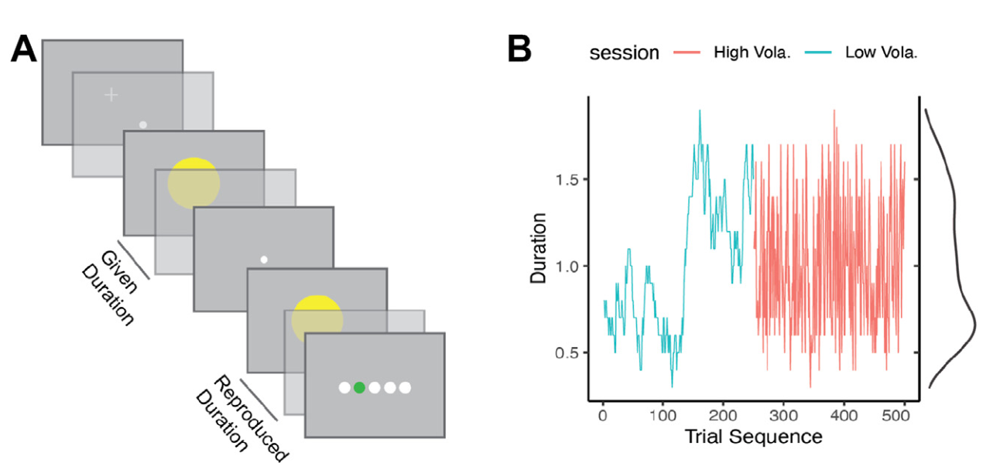
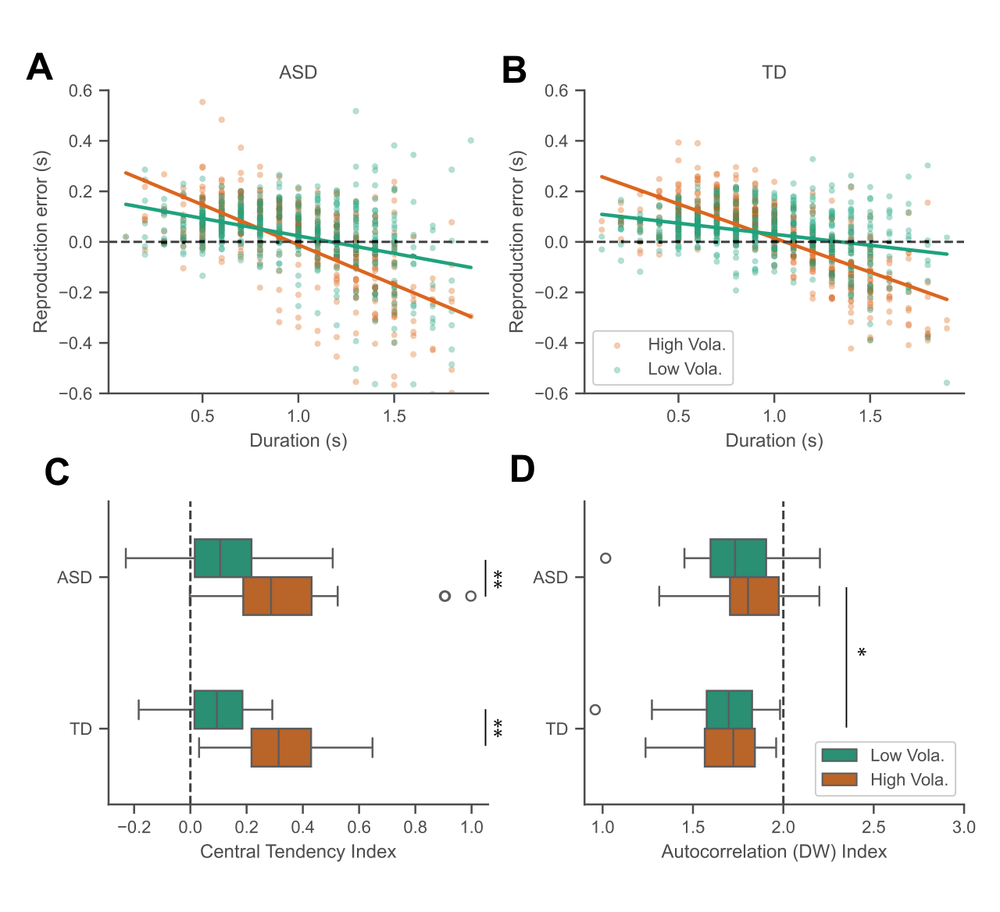
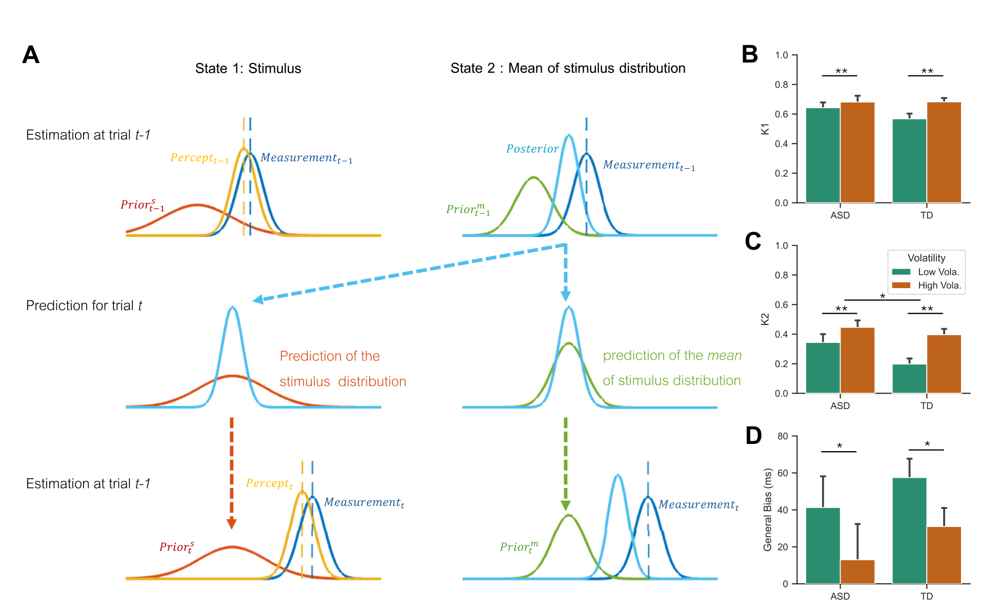
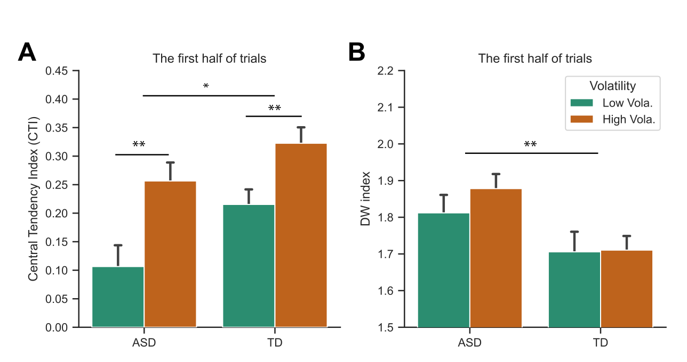

A yellow circle appears for 1.6 seconds. After it disappears, you hold down a mouse button for what feels like the same duration. The reproduction is often too short. When the circle lasts only 0.4 seconds, the reproduction tends to be too long. Errors are structured: short intervals are pulled upward and long intervals downward, toward the recent mean.

This central tendency reveals that a judgment uses more than the current stimulus. A noisy sensory measurement is combined with the durations encountered over previous trials.

Autistic people report many kinds of sensory difference, including heightened sensitivity to sound, light, and detail, as well as uncertainty when environments change. Pellicano and Burr proposed in 2012 that autistic perception is constrained less strongly by prior knowledge, making current sensation more vivid and the world “too real.” Later studies did not converge. Some found weaker central tendency or adaptation, some found no group difference, and others attributed differences to slower updating or an overestimate of environmental volatility.

These accounts all use the word *prior*, but they describe two computations. During a trial, the observer decides how much past experience should influence the present estimate. After the trial, the observer decides how much the newest event should alter the expectation carried into the next trial. Shi, Allenmark, Falter-Wagner and colleagues designed a duration experiment to estimate these steps separately.

## The same durations in a different order

The study included 32 autistic adults and 32 typically developing adults matched pairwise on age and fluid intelligence. Durations ranged from 100 to 1,900 ms. Participants first held a mouse button while the yellow circle was visible, waited 500 ms, and then reproduced its duration with a second press. Five dots indicated the size of the error after each trial.

Each participant completed two sessions of 250 trials. Both sessions contained exactly the same set and frequency of durations. Only order changed. In the low-volatility sequence, a random walk made adjacent durations similar. In the high-volatility sequence, the same durations were shuffled so that successive trials jumped widely. Matched participant pairs saw identical sequences, and condition order was counterbalanced.

Because distribution, range, and frequency were held constant, the manipulation isolated temporal structure. Trialwise feedback made updating easier to observe, but also introduced an ambiguity: a fitted update might reflect sensory learning, correction of button duration, or both.

## The full session shows no central-tendency group difference

The paper quantified central tendency with the slope relating reproduction error to physical duration. A central-tendency index, or CTI, near zero means that reproductions mostly track the current stimulus. A value near one means that different durations collapse toward a common response.

Both groups showed clear central tendency, and it was stronger in the shuffled sequence, F(1,62)=80.11, p<.001, partial η²=.56. Across all 250 trials there was no main effect of group and no group by volatility interaction. Mean overestimation also did not differ.

This is already important. Autistic participants did not simply ignore experience. They used the distribution and adjusted behavior when sequential volatility changed.

After removing effects of current duration and overall central tendency, residual errors remained positively autocorrelated in both groups. A Durbin-Watson statistic of two indicates no first-order autocorrelation; values below two indicate that a long response tends to follow another long response. The autistic group was closer to two, F(1,62)=4.50, p=.038. This tells us that sequential dependence was weaker, but not whether the difference occurred during integration, updating, or motor production.

## Two gains separate using from updating

The authors used a two-state iterative model derived from Kalman filtering. Let \(z_t\) be the sensory measurement on trial \(t\), and \(\hat\mu_{t-1}\) the estimated mean of the duration distribution before that trial. The reproduced duration is:

The first gain, \(K_1\), controls how much the current measurement contributes. When \(K_1\) approaches one, the estimate follows \(z_t\). When it is smaller, the previous mean receives more weight. The constant \(c\) captures general overestimation or underestimation.

The same measurement then updates the mean used on the next trial:

The second gain, \(K_2\), controls how far the internal mean moves toward the latest observation. A small \(K_2\) preserves older history. A large one makes the mean responsive to recent input and causes earlier observations to decay faster.

The distinction is easiest to see numerically. Suppose the prior mean is 1,000 ms and the current measurement is 1,600 ms. With \(K_1=.60\), the current estimate is 1,360 ms; with \(K_1=.68\), it is 1,408 ms. \(K_2\) does not change that report. It changes what the next trial inherits. If measurements of 1,600 and 400 ms arrive in sequence, \(K_2=.297\) moves the mean to about 1,178 and then 947 ms. With \(K_2=.395\), it moves to about 1,237 and then 906 ms.

Unrolling the second equation shows an exponentially weighted history. The newest measurement has weight \(K_2\), the previous one \(K_2(1-K_2)\), and every further step adds another factor of \((1-K_2)\). The corresponding single-sample half-life falls from about 1.97 trials at .297 to 1.38 trials at .395.

The effect of the previous trial on the current report requires both steps:

The previous observation first changes the internal mean through \(K_2\), and that mean enters the current estimate through \((1-K_1)\). Calling their product “prior strength” would erase the difference between using experience and changing it.

## The group difference appears in updating

\(K_1\) changed with sequence volatility, averaging .682 in the shuffled condition and .605 in the smooth condition, F(1,62)=10.61, p=.002. It showed no group effect or interaction. Within this model, autistic and control participants gave similar relative weight to current sensation and the existing mean when forming the present estimate.

\(K_2\) changed with both volatility and group. It averaged .42 in the shuffled sequence and .27 in the smooth sequence. Across conditions it was .395 in the autistic group and .297 in controls, F(1,62)=4.23, p=.04. There was no group by volatility interaction.

The direct result is that the autistic group had a larger fitted update gain. The authors interpret this as weaker use of stability across successive events: the newest measurement shifts the next expectation more, while the collective constraint from older events decays faster. The experiment did not independently measure a belief about continuity, so that last step remains an interpretation of the parameter.

A larger update is not automatically better learning. In a changing environment, it allows fast adaptation. In a stable environment, a noisy observation produces a larger disturbance. For independent observations around a fixed mean, the stationary variance of the internal estimate is proportional to \(K_2/(2-K_2)\). Substituting the group means raises this coefficient from .174 to .246, about 41 percent. Faster correction and a less stable running mean are two consequences of the same gain.

## The first half of the session requires caution

The authors also analyzed the first 125 trials. After excluding three autistic participants with CTI values above .9 in the high-volatility condition and their matched controls, autistic participants showed weaker central tendency, F(1,56)=6.236, p=.015. The difference was absent across all 250 trials. This motivated a proposal that autistic participants eventually form a similar global bias but require more events.

That interpretation is plausible but not established. The exclusion moved the mean in the direction of the reported group effect. The 125-trial sample is contained inside the 250-trial sample, and the paper did not test a group by time-block interaction. A fixed-gain model also loses the influence of its initial state quickly: with gains around .3 to .4, little initial error remains after ten trials. The data support a local update difference more directly than a hundred-trial delay in global learning.

The three excluded participants are scientifically interesting. In the shuffled sequence they almost stopped distinguishing durations. Their fitted \(K_1\) and \(K_2\) were near .07 and .04. Yet they tracked duration in the smooth sequence, so misunderstanding the task is unlikely. They may have treated large jumps as noise and fallen back on an established mean.

This pattern points in the opposite direction from the average effect. Most autistic participants gave new input more influence; these three almost ignored it in a volatile context. A diagnostic group can contain strategies that look behaviorally opposite. Hierarchical or mixture models and repeated within-person measurements are better suited to determining whether these are points on one continuum or reproducible subgroups.

## What the model has and has not shown

The two-state model fit better than linear and dynamic regression alternatives, and parameter-recovery tests showed that \(K_1\) and \(K_2\) can be recovered from data generated by the model. That establishes internal identifiability, not biological uniqueness. Attention, sensory noise, response persistence, and feedback-based motor calibration could mimic parts of the same pattern.

Model-based and model-free results did not fully align. Substituting group means into the sequential coefficient predicts a previous-trial influence of about .142 for autistic participants and .107 for controls. Yet a direct regression on previous duration found an effect of volatility but no group difference. The fitted \(K_2\) effect therefore needs replication with converging measures. It was also unrelated to autism-trait scores.

The study improves the question. “Are autistic priors weak?” is too coarse. We should ask which past events enter the current judgment, how rapidly new evidence changes the latent expectation, whether the environment is assumed to remain stable, and whether the same computation survives when feedback and motor reproduction are removed.

The most useful distinction is ordinary enough to recognize outside the laboratory. Knowing what usually happens and deciding what one exception means are not the same achievement. A person can learn the usual schedule and still revise tomorrow’s expectation strongly after one delay. The experiment does not reduce autistic perception to a single mechanism. It shows why the mechanism must be split before it can be tested.

## References

Shi, Z., Allenmark, F., Falter-Wagner, C. M., et al. (2025). Prior updating in autistic perception: Evidence from interval timing. *Biological Psychiatry: Global Open Science*.

Pellicano, E., & Burr, D. (2012). When the world becomes too real: A Bayesian explanation of autistic perception. *Trends in Cognitive Sciences*, 16, 504-510.

Glasauer, S., & Shi, Z. (2022). The origin of Vierordt’s law: The experimental protocol matters. *PsyCh Journal*, 11, 732-741.
