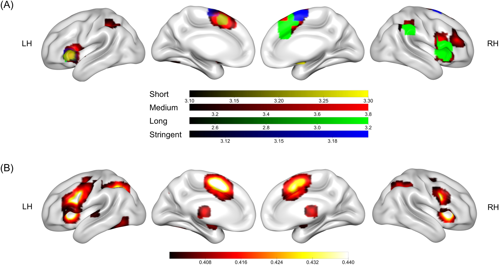
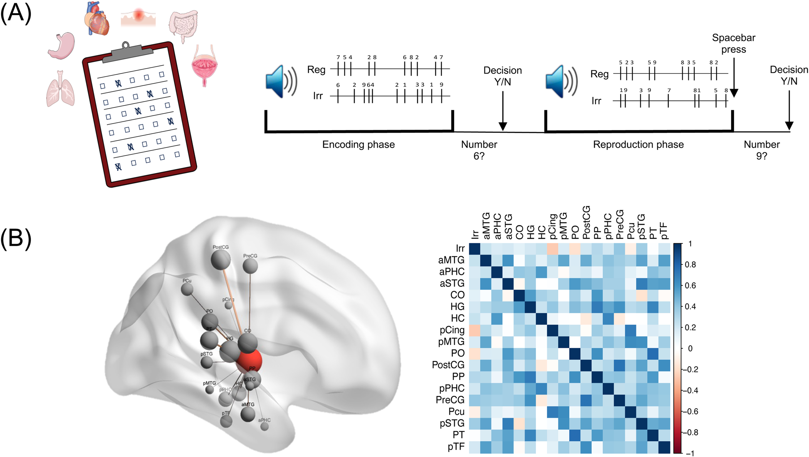
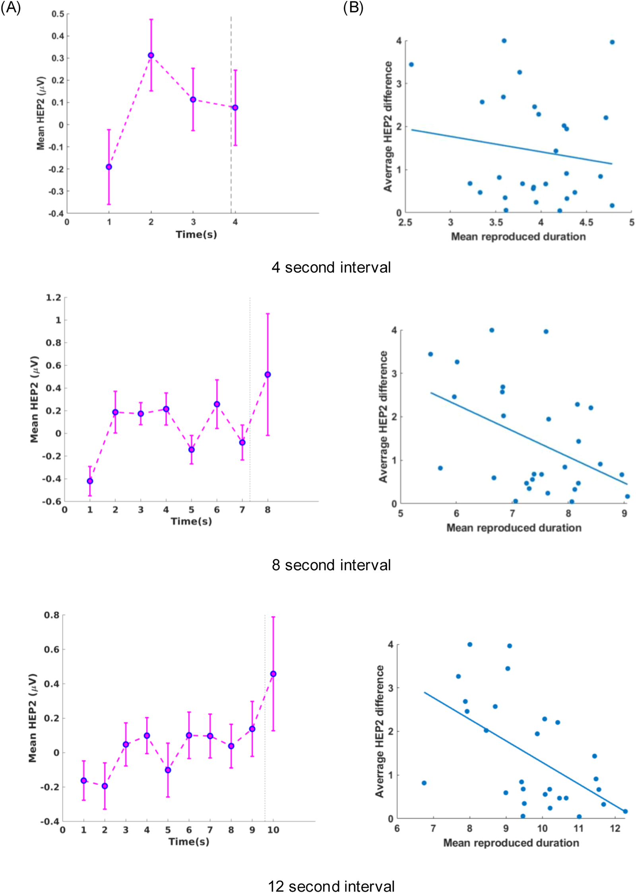
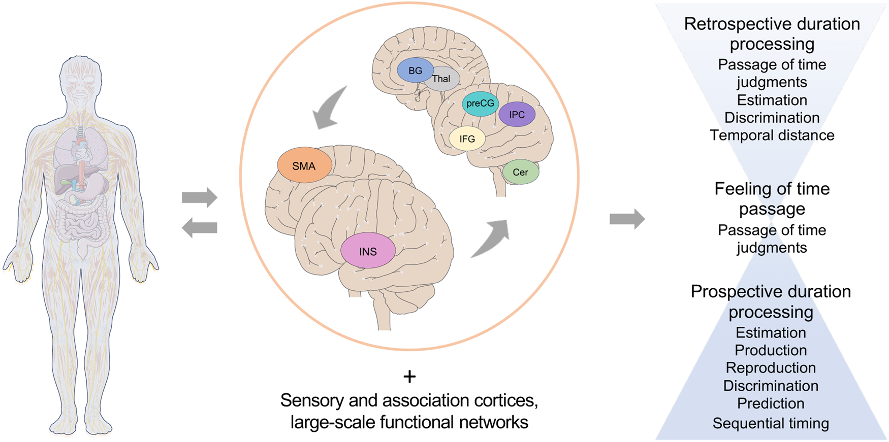

We rarely experience time as a naked number. Waiting tightens the body. Fear changes the heart. A deliberate movement divides an interval into before and after. The intuition that the body participates in time is compelling, but it leaves a computational question unanswered: does the body carry information about duration, or does it merely change how the brain encodes, judges, and reports duration?

A review by Teghil and Wittmann brings together neuroimaging, electrophysiology, psychophysiology, and lesion evidence. It identifies the insula and supplementary motor area, or SMA, as recurring hubs. The anatomical claim is strong. The computational claim remains open.

## Timing models do not specify where evidence must come from

Pacemaker-accumulator models count pulses. State-dependent models infer elapsed time from the position of a changing neural trajectory. Striatal beat-frequency models read the combined phase of multiple oscillators. Bayesian models combine noisy current evidence with a distribution of familiar intervals.

None requires the input to be exclusively cerebral. Heart rate and arousal can alter pulses. Respiration, viscera, and movement can drive neural trajectories. Bodily rhythms can couple to neural oscillations. A Bayesian observer can treat bodily state as another uncertain cue.

But change is not automatically a clock. Heart rate changes with exercise, emotion, temperature, and medication. Eight seconds at 60 beats per minute contains about eight beats; eight seconds at 90 contains twelve. Without estimating the current rate, a beat count cannot distinguish a longer duration from a faster heart.

We must also separate estimating “ten seconds” from feeling that time passes slowly. Prospective timing directs attention toward time while an event unfolds. Retrospective timing reconstructs duration from memory afterward. The body can affect all of these without using one mechanism.

## Why the insula and SMA keep appearing

Naghibi and colleagues combined 97 contrasts from 95 duration studies, separating short, medium, and long intervals, sensory modalities, perceptual and motor tasks, single events and sequences, and estimation from prediction. The insula and SMA remained stable across these divisions. In experiments with carefully matched control conditions, convergence narrowed to the left anterior insula and SMA. The left insula was the only region present across all three duration ranges.

Mondok and Wiener compared 114 explicit timing studies with 9,953 fMRI studies of other functions. A standard forward inference asks where activation occurs during timing. Their reverse inference asked how strongly activity in a region predicts that a participant is timing. The highest posterior probabilities again appeared in the left SMA and bilateral anterior insula.

This establishes involvement, not computation. The insula also supports interoception, salience, and emotion. SMA supports action selection, inhibition, and sequence organization. Stable activation could represent duration, tune attention, set a decision criterion, or organize the response.

## A minimal embodied inference model

Represent bodily state at time \(t\) as a vector:

Here \(h(t)\) denotes cardiac information, \(r(t)\) respiration, and \(a(t)\) motor or autonomic activity. The real state is much larger. The point is that the brain observes several correlated changing streams.

If it has learned how bodily trajectories evolve in a context, it could infer elapsed duration from the observed path:

The likelihood asks how probable the trajectory is if duration \(T\) elapsed under context \(C\). The prior describes familiar durations in that context. For this account to work, different durations must yield statistically distinguishable trajectories. Analysis must also avoid leaking the answer by giving a decoder a window whose sample count already grows with \(T\).

A heartbeat count offers a simple illustration. Treat beats temporarily as Poisson events with rate \(\lambda\). The count \(N\) within duration \(T\) follows:

If \(\lambda\) is known and stable, \(N/\lambda\) estimates \(T\), and the Fisher information is:

At a higher known rate, relative precision improves. If rate is unknown, however, one count mainly identifies the product \(\lambda T\). The same observation can mean more time or a faster heart. Real heartbeats are not assumed to be Poisson; the example exposes a necessary calibration problem.

Three computational roles are often merged under the phrase “the body participates in timing.”

| Bodily role | Computation | Discriminating evidence |
|---|---|---|
| Duration evidence | Beats, movements, or trajectories carry information about \(T\) | Bodily features predict duration across tasks after rate, arousal, and movement are controlled |
| State modulation | Bodily state changes gain, noise, attention, or internal clock speed | Bias or variability changes even when bodily signals cannot independently decode \(T\) |
| Decision and response | Duration is already encoded, but the body changes memory, criterion, or stopping | Effects concentrate near response and vary across discrimination, estimation, and reproduction |

These roles can all produce a correlation between body and behavior. A theory must say which one it predicts.

## When external rhythm is unavailable

In one experiment, participants heard number sequences and reproduced their duration. A regular sequence supplied an external beat; a random sequence did not. Resting connectivity between posterior insula and sensorimotor regions predicted reproduction accuracy only in the random condition.

The result fits an embodied account in which bodily cues receive more weight when external cues are unreliable. It also fits a general difficulty account in which a random task demands more attention or state regulation. Resting connectivity does not reveal which bodily variable encoded duration.

## What heartbeat-evoked potentials show

Each ventricular contraction produces an R peak in the ECG. Averaging EEG relative to these peaks yields a heartbeat-evoked potential, or HEP, which indexes neural processing of cardiac signals.

Khoshnoud and colleagues asked 28 participants to reproduce sounds lasting 4, 8, or 12 seconds. A component 470 to 520 ms after the R peak changed from second to second during 8- and 12-second reproductions. The larger its increase from beginning to end, the shorter the reproduced duration: r(26)=-.38 for eight seconds and r(26)=-.55 for twelve. No significant relationship appeared at four seconds.

This links a bodily neural response to single-trial timing more directly than a questionnaire or resting-state measure. It still does not make the HEP a duration accumulator. Reproduction combines timing with holding and releasing a key. HEP change could encode elapsed time and trigger release, or movement maintenance and stopping could affect both HEP and response time. A duration-discrimination task without sustained action would help separate the paths.

The absence of a significant four-second correlation does not itself prove a mechanism begins after four seconds. Short trials may contain too little signal, or participants may use different motor strategies. A formal duration by HEP interaction is needed; significance in one condition and nonsignificance in another does not establish a difference.

At subsecond scales, stimuli during cardiac diastole are judged slightly longer than stimuli during systole, and a slower prestimulus heart rate predicts longer estimates below 500 ms. These results show that cardiac state can modulate early sensation or decision. They do not yet show that heartbeats provide an independent temporal coordinate.

## One body, several time scales

A common anatomical entry point does not guarantee a common computation from milliseconds to minutes.

Within a heartbeat, cardiac phase may alter sensory gain or precision. Across several seconds, bodily and neural states have time to form trajectories that could be read out. Across minutes, experiments often ask how quickly time seems to pass, shifting the target toward emotion and self-state. In retrospective judgments, the hippocampal system reconstructs an episode, and bodily state may be stored as event content rather than counted online.

Emotion exposes the scale dependence. Highly arousing negative stimuli are often judged longer, yet salient stimuli can draw attention away from timing and produce underestimation. During laboratory waits, higher arousal can accompany slower felt passage. In daily-life sampling across hours, increased heart rate and skin conductance have sometimes accompanied faster felt passage. These findings do not collapse into one rule that arousal speeds an internal clock.

The review’s framework places bodily input into the insula, motor control near SMA, and both within networks including basal ganglia, thalamus, cerebellum, frontoparietal cortex, and sensory systems.

The framework identifies anatomical interfaces. It does not decide whether a bodily signal is an input, precision modulator, or readout.

## A sharper experimental test

A useful experiment would have the same participants perform both duration discrimination without sustained movement and duration reproduction with a key press. It would independently manipulate bodily rhythm and reliability of external temporal cues while recording ECG, respiration, EEG, and action.

Three models make different predictions. If bodily trajectories provide duration evidence, both tasks should change, with effect size tracking cross-validated decodability of \(T\) after controlling arousal and motion. If the body modulates encoding, sensitivity, bias, or variability should change while bodily signals need not decode duration independently. If it changes readout, effects should be stronger in reproduction or concentrate immediately before response.

Hierarchical models can combine trials, participants, and tasks. Parameter recovery can show whether a mechanism is estimable, and model recovery whether the candidate mechanisms can masquerade as one another. These checks do not replace causal identification because controlled breathing or movement also changes arousal, attention, and EEG artifact.

The field no longer lacks correlations between timing and heartbeat, respiration, or action. It lacks a precise location for those signals inside the computation. The insula and SMA provide stable places to ask the question. They do not answer it for us.

## References

Teghil, A., & Wittmann, M. (2025). How the body and brain process time. *Neuroscience & Biobehavioral Reviews*, 179, 106416.

Naghibi, N., et al. (2024). Embodying time in the brain: A multi-dimensional neuroimaging meta-analysis of 95 duration processing studies. *Neuropsychology Review*, 34, 277-298.

Mondok, C., & Wiener, M. (2023). Selectivity of timing. *Frontiers in Human Neuroscience*, 16, 1000995.

Khoshnoud, S., et al. (2024). When the heart meets the mind. *Journal of Neuroscience*, 44.
