A memory is often treated as evidence held still until a decision reads it. But a readout can feed back into the state it reads. Once we decide that a remembered grating was clockwise from a reference, the memory itself may move in the direction of that choice.

Gu and colleagues designed a task that exposes two sources of distortion. Participants remembered an orientation, judged whether it lay clockwise or counterclockwise from a reference, and later reproduced the original angle continuously. The categorical judgment occurred either early or late within a retention interval of equal total duration.

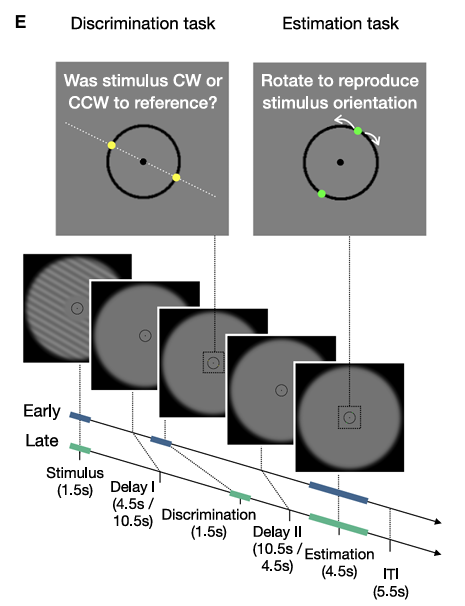

The final report contains two biases. A stimulus-specific bias depends periodically on physical orientation, as if some locations in orientation space attract memory more strongly. A decision-consistent bias pulls estimates toward the category that was chosen. Moving the judgment within the delay separates drift before decision from change after decision.

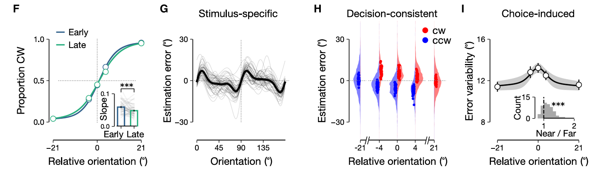

## Memory as drift and diffusion

Let \(m_t\) denote a remembered orientation. A drift-diffusion account writes its evolution as deterministic drift through an orientation-dependent field plus stochastic diffusion:

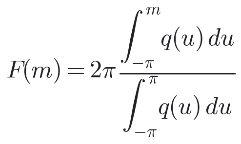

The drift is derived from a periodic potential. Stable points attract nearby states; unstable points repel them. This creates a stimulus-specific bias that grows during retention. Diffusion alone increases uncertainty but cannot create the observed direction-dependent mean errors.

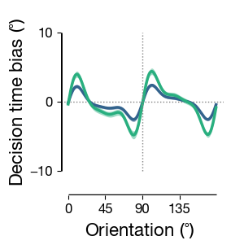

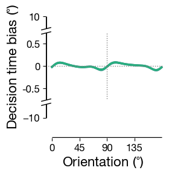

The binary decision is obtained by comparing the noisy state with a reference. Conditioning on choice already separates latent states near the boundary: trials labeled clockwise and counterclockwise were not identical even before a categorical response. But conditioning alone was insufficient. The model required a choice-consistent displacement after judgment, followed by continued attractor drift.

This combination explains why reports near the boundary are especially variable. Nearly identical physical stimuli can fall on different sides through noise. Choice conditioning separates their latent states, feedback moves them farther toward the selected category, and subsequent drift amplifies or reduces that separation depending on local geometry.

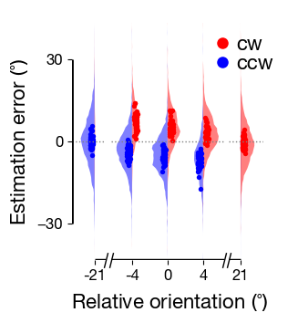

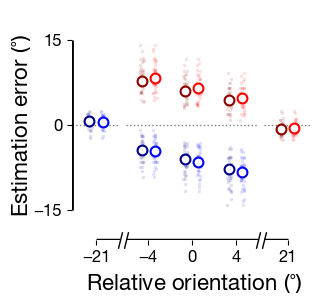

## The representation changes when the decision happens

The behavioral model predicts when bias should appear in the remembered representation. fMRI patterns from visual cortex were decoded into orientation trajectories. Before judgment, decoded angles gradually developed the periodic stimulus-specific bias. Around and after judgment, trajectories separated according to choice.

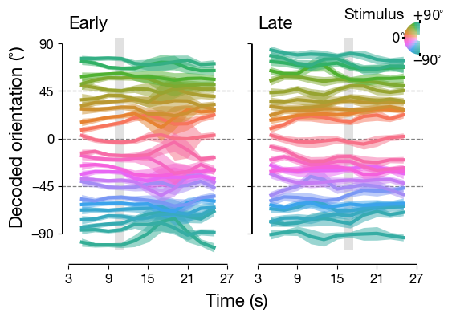

This matters because a distorted final report could arise only at response. A time-resolved neural bias suggests that the maintained representation itself changes. Decoding remains an indirect population-level measurement, however. A biased decoder can reflect changed representational geometry, altered readout, or both.

## A recurrent network trained on the task

The authors trained recurrent neural networks with 96 units. Inputs specified stimulus orientation and reference orientation. Outputs produced the binary clockwise decision and the later continuous estimate.

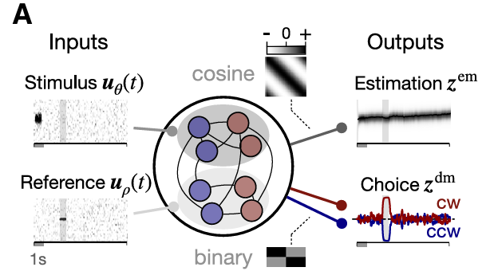

No explicit attractor landscape or choice-feedback rule was inserted. Heterogeneous networks nevertheless developed both biases. Orientation states formed a ring-like manifold, but distances along the ring were uneven. Compressed regions and expanded regions corresponded to the network’s stimulus-specific errors.

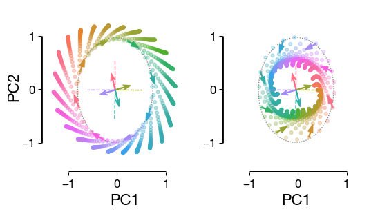

The decision population also fed back into the estimation population. In state space, this feedback displaced activity along a choice-dependent direction. Cutting the connection reduced choice-consistent bias and changed variability near the reference. Retraining only the output layer partially restored task performance, but did not restore the original recurrent dynamics.

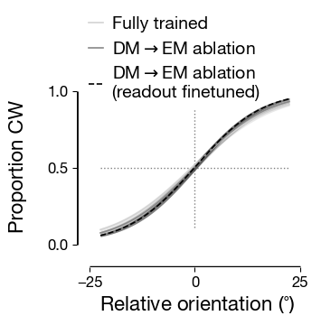

This distinction is crucial. Similar behavioral accuracy can be recovered by a new decoder even when the internal mechanism has changed. Performance alone does not certify that a model has recovered the biological computation.

## State change or landscape change?

Decision feedback might move the state within an unchanged attractor landscape. Alternatively, it might change the vector field itself, so that later memory evolves under different dynamics. These accounts can produce similar endpoint biases.

The paper’s state-space analyses favor a choice-related displacement, but do not fully identify whether the postdecision landscape is invariant. A stronger test would estimate local flow fields before and after choice, perturb matched states, and ask whether their subsequent trajectories differ. If matched states evolve differently after a decision, the dynamics changed. If they evolve alike, the decision mainly changed position.

## What the study changes

The result is not merely that memory is noisy. Noise broadens a distribution. Here, memory moves systematically because orientation space is nonuniform, and then moves again because a categorical commitment returns to the remembered state.

This offers a general warning for sequential cognition. When a system makes a choice, that choice is not necessarily a passive report. It can become a new input. The next judgment then begins from evidence already reshaped by the previous one.

Behavior establishes two biases and their timing. Neural decoding shows corresponding evolution in visual representations. Task-optimized RNNs demonstrate one mechanism capable of producing both through warped attractor geometry and decision feedback. None alone proves the mechanism, but the convergence is stronger than any endpoint curve.

## Reference

Gu, Q., et al. (2025). Attractor dynamics in working memory produce stimulus-specific and decision-consistent biases. *Neuron*.
