A foundation model promises reuse. Pretrain once on broad data, then adapt to sleep staging, seizure detection, motor imagery, affect, pathology, or a new hospital with little labeled data. For language and images, common tokenization and massive benchmarks make that promise easy to state. EEG resists every part of it.

Electrodes differ across datasets. Sampling rates, references, filters, amplifiers, tasks, pathologies, and recording lengths differ. Intracranial signals and scalp EEG do not share the same spatial meaning. A model can call itself general while succeeding only after task-specific preprocessing and full fine-tuning.

A 2026 review in *Journal of Neural Engineering* compared ten early neural foundation models. The important result is not a leaderboard. Published evidence is too heterogeneous to rank them fairly. The comparison instead reveals the design choices hidden inside “pretrain and transfer.”

## Four questions before reading a score

First, what is the unit presented to the model: waveform samples, spectral patches, learned tokens, or discrete codebook entries?

Second, how does it represent space? Channel order is not anatomy. A montage-specific embedding can be powerful and brittle. Channel-independent processing is flexible but may discard relationships.

Third, what must pretraining predict: a masked waveform, a spectrum, a latent vector, a code, a future segment, or agreement between augmented views?

Fourth, what does “transfer” mean? A linear probe tests whether the frozen representation already exposes task information. Full fine-tuning tests whether initialization helps after the entire model changes. They answer different questions.

## BrainBERT and Brant: starting inside the skull

BrainBERT converts a single intracranial channel into a time-frequency representation and treats spectral patches like a sequence. Masked patches are reconstructed during pretraining; downstream tasks retain the encoder and add a head.

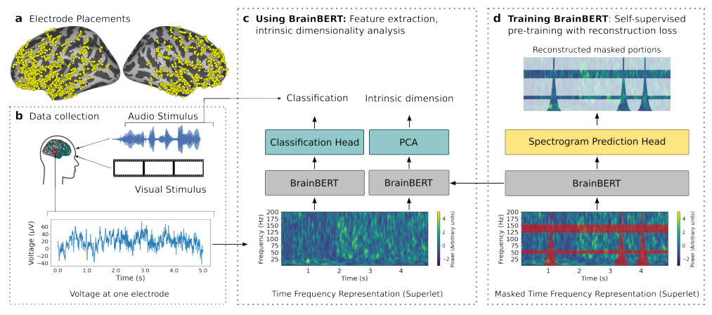

Its strength is a stable local vocabulary. Its limitation is equally clear: learning one electrode at a time postpones the spatial problem.

Brant scales intracranial training to roughly 281,000 channel-hours from nine participants. A temporal encoder links segments within a channel, while a spatial encoder combines channels around the same time. A linear head reconstructs masked segments.

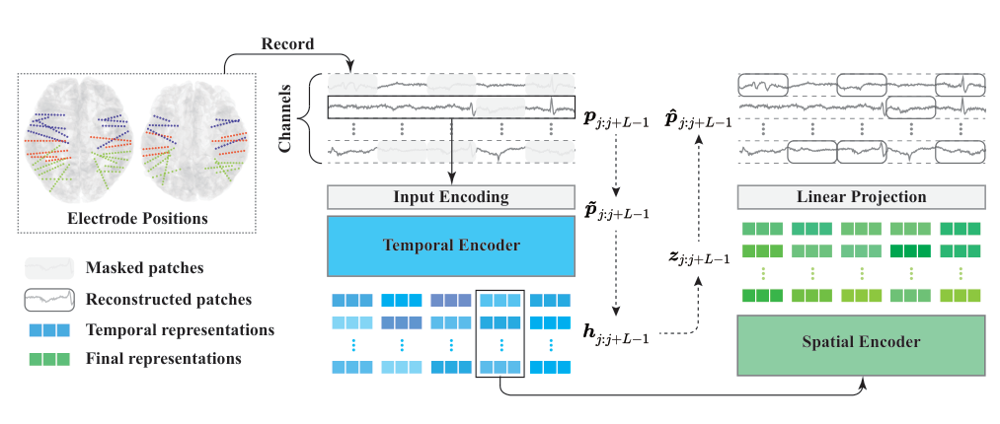

Scale here means many hours and electrodes, not many independent brains. Correlated samples from a small participant pool can teach rich signal structure without guaranteeing population transfer.

## Four approaches to clinical scalp EEG

Neuro-GPT maps raw EEG into latent vectors, masks one, and uses a GPT-2-style causal module to predict it from earlier vectors. Loss is computed in latent space rather than directly on voltage.

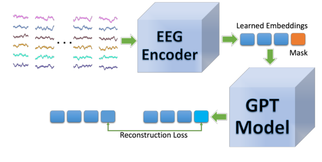

This emphasizes temporal prediction, but causal ordering can privilege information from the past even when a downstream clinical task benefits from bidirectional context.

BIOT is a compact model, around 3.3 million parameters, that segments each channel, converts segments into frequency-domain tokens, and uses a linear transformer. Contrastive pretraining brings two views of a recording together while separating recordings.

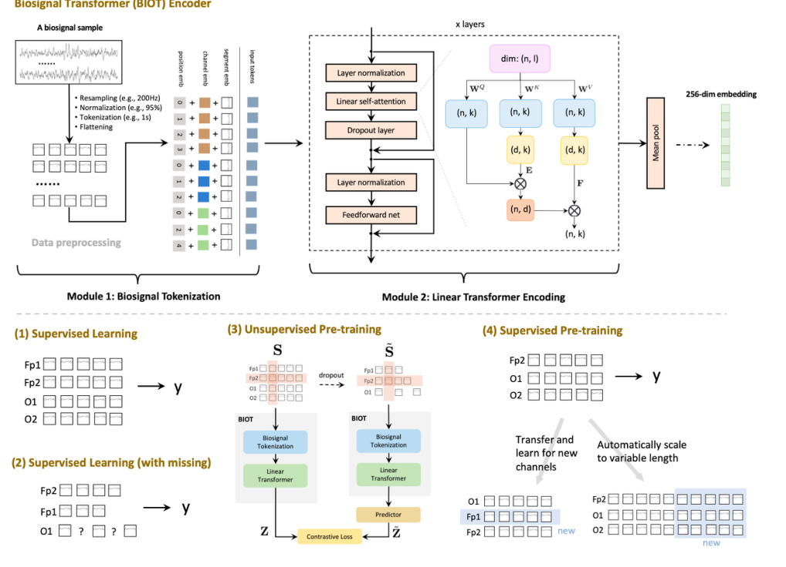

Frequency tokens help with sampling and duration variability. Contrastive success depends heavily on augmentation: if an augmentation removes clinically meaningful structure, invariance becomes information loss.

EEGFormer uses vector quantization. An encoder maps multichannel segments into latent vectors, a discrete codebook replaces them with learned entries, and a decoder reconstructs the signal. Codewords can be traced back to representative waveforms.

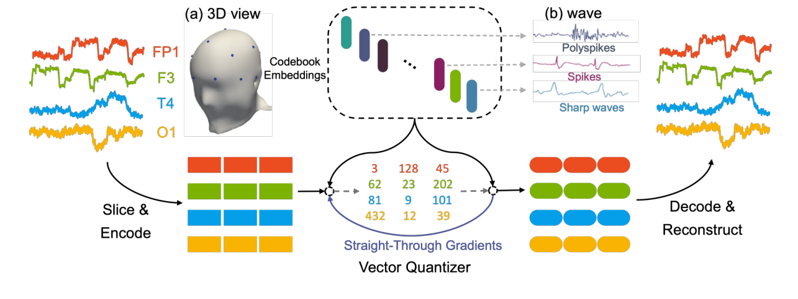

Discrete codes provide a potential interpretability handle. They do not explain themselves. A codeword may combine physiology, artifact, reference choice, and dataset identity.

Mentality is the only model among the ten that does not rely on a transformer. Frequency filtering and channel mixing feed a multiscale Mamba encoder-decoder with downsampling, upsampling, and skip connections.

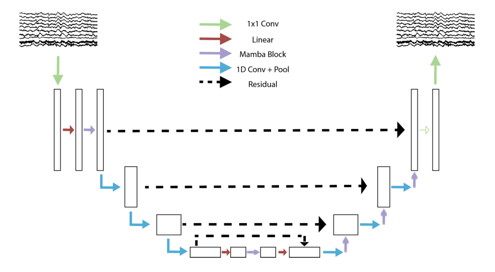

Its inclusion is a useful control. If a state-space model matches a transformer, the scientific claim cannot be that attention itself created generality.

## LaBraM and NeuroLM: a learned neural vocabulary

LaBraM first learns a tokenizer. Short electrode segments pass through a convolutional temporal encoder, then time and spatial embeddings identify each patch. Vector quantization assigns discrete neural codes while preserving spectral magnitude and phase. The main model is later trained to predict the code of masked patches.

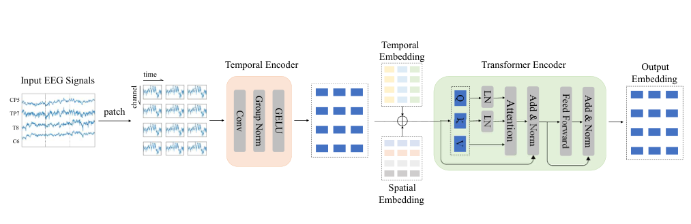

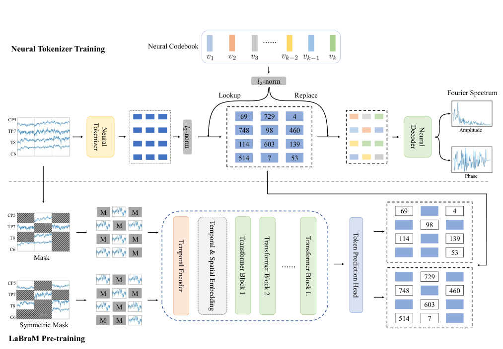

This separates local signal compression from contextual modeling. The codebook also creates a bottleneck: anything the tokenizer discards cannot be recovered by a larger transformer.

NeuroLM extends the vocabulary idea toward language. Convolution and spatial encoding feed a quantized codebook. Decoders reconstruct time waveforms and spectra, while an auxiliary classifier aligns EEG embeddings with text embeddings. Discrete neural tokens can then enter a causal language model alongside instructions and answers.

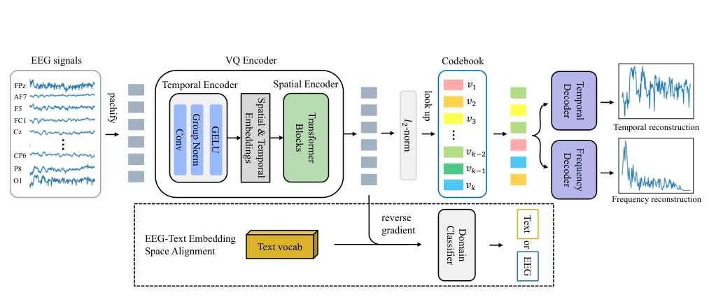

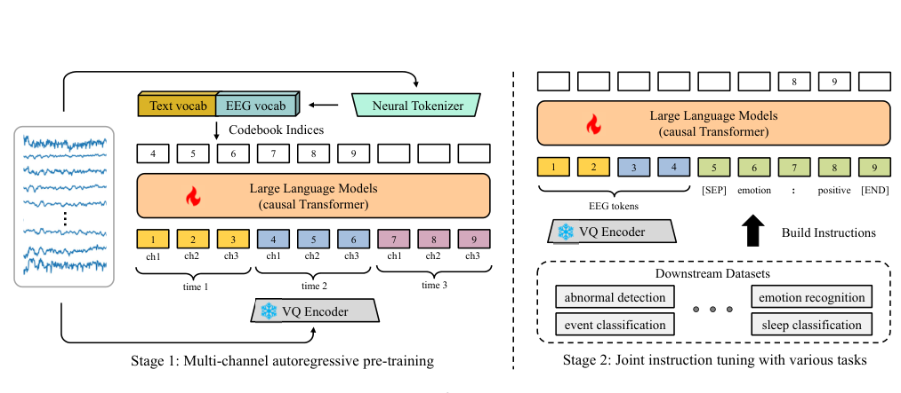

This creates a powerful interface but also a new ambiguity. Good instruction following can come from the language model’s prior and task wording rather than a general neural representation. Controls must vary prompts and remove EEG to measure what the signal adds.

## FoME and BrainWave: mixing modalities and scales

FoME accepts scalp and intracranial data. Waveform segments and frequency-band energy form tokens. Attention first operates within a channel over time; tokens are then rearranged for cross-channel attention.

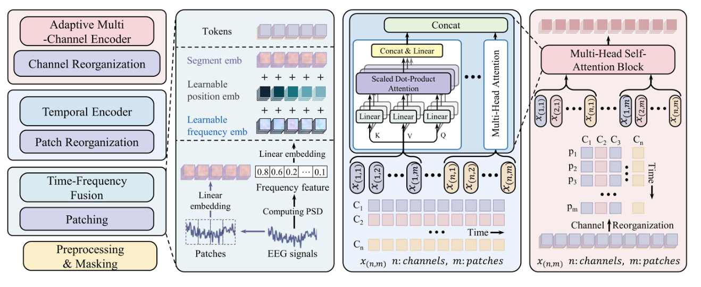

The factorization makes temporal and spatial assumptions visible. Transfer still depends on how channel identity and missing electrodes are represented.

BrainWave reports the largest pretraining collection in the comparison and one of the clearest few-shot evaluations. Signals at different electrode and sampling scales are normalized into time-frequency patches, processed by a transformer and channel attention, and trained through masked spectral reconstruction.

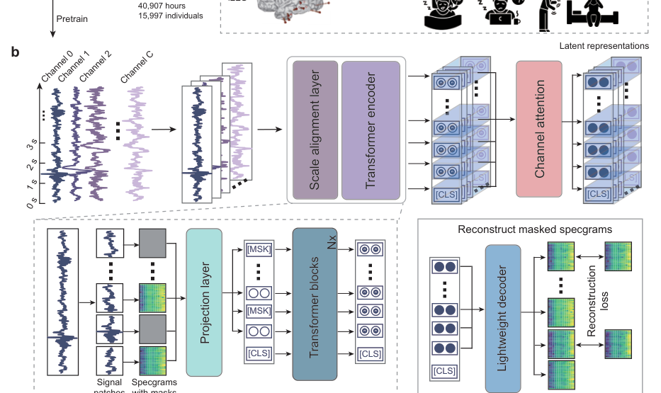

For downstream transfer, a small labeled support set creates class prototypes. New samples are classified by similarity, including across participants, hospitals, and subtypes.

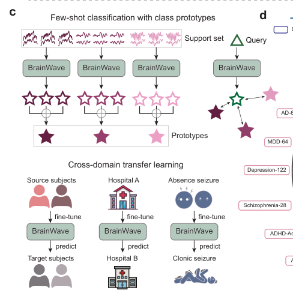

## Why published benchmarks cannot rank the models

The review organizes each system by input representation, architecture, pretraining objective, and evaluation.

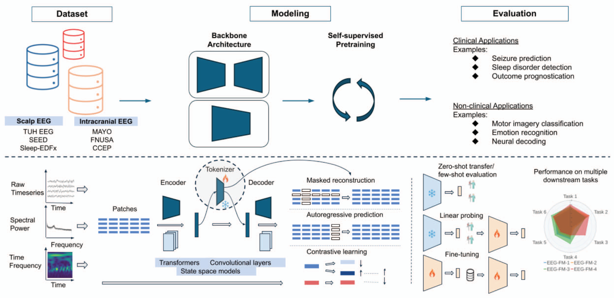

Scores often come from different preprocessing, train-test splits, label definitions, channel subsets, and adaptation budgets. Even common datasets such as TUAB and TUEV do not guarantee common evaluation. One paper reports full fine-tuning, another a linear probe. One selects epochs using a test-adjacent validation set; another holds out hospitals. Average AUC and macro F1 also reward different error profiles.

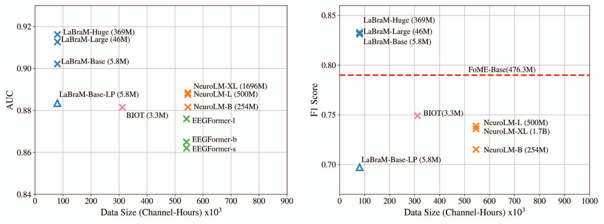

Three results run against a simple scaling story. More data and parameters do not reliably produce better published scores. General-purpose sequence architectures sometimes outperform EEG-specific designs. Some models are weak under a frozen linear probe but improve substantially when fully fine-tuned.

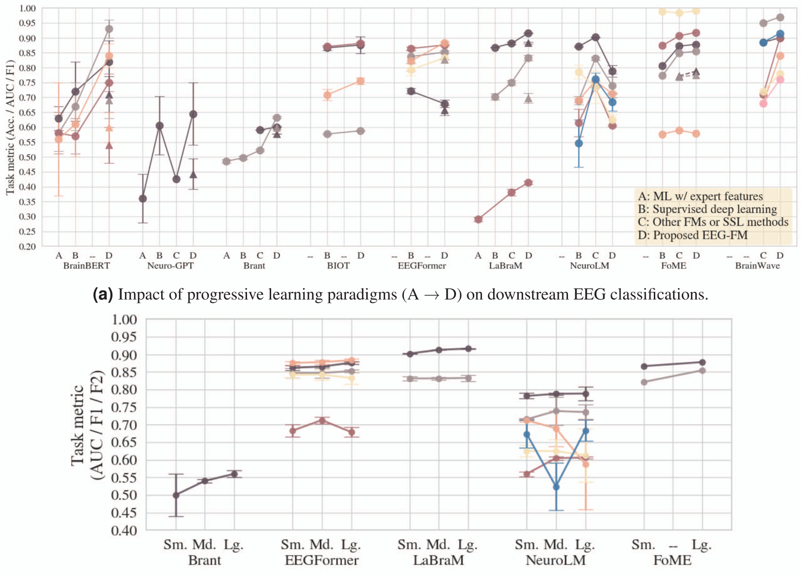

The last pattern means that a model can be a useful initialization without providing an off-the-shelf representation. Calling both cases “foundation model transfer” hides the distinction.

## A benchmark that could answer the real question

A fair evaluation needs fixed raw datasets and splits, transparent preprocessing, multiple channel regimes, and a controlled adaptation ladder: frozen probe, parameter-efficient tuning, full fine-tuning, few-shot prototypes, and training from scratch. Compute, labeled examples, and hyperparameter search must be matched.

It should test four kinds of shift separately: new participant, new session, new hardware or montage, and new clinical site. It should report calibration and subgroup performance, not only discrimination. Ablations should remove spatial metadata, pretraining data families, and task prompts to identify where transfer comes from.

Finally, leakage must be audited at person and recording level. Random windows from the same long recording can make a representation appear transferable while it recognizes recording-specific noise.

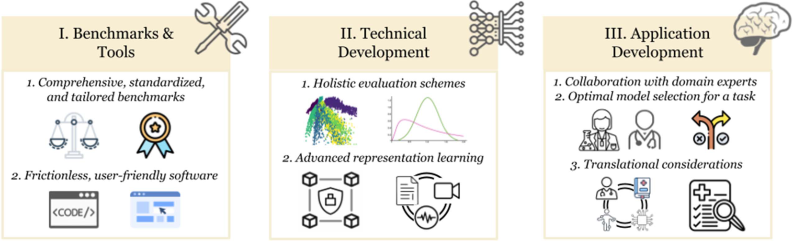

The early models are valuable because they expose the design space. None yet establishes a universal neural vocabulary. The right question is not which architecture has the largest number beside it. It is what remains usable when the electrodes, person, hospital, task, and adaptation budget all change.

That is what “off the shelf” would have to mean.

## References

Kuruppu, S., et al. (2026). Foundation models for EEG: A review of early architectures and evaluation. *Journal of Neural Engineering*.

Primary architecture figures and model descriptions are attributed in their captions to the BrainBERT, Brant, Neuro-GPT, BIOT, EEGFormer, Mentality, LaBraM, NeuroLM, FoME, and BrainWave papers reviewed there.
