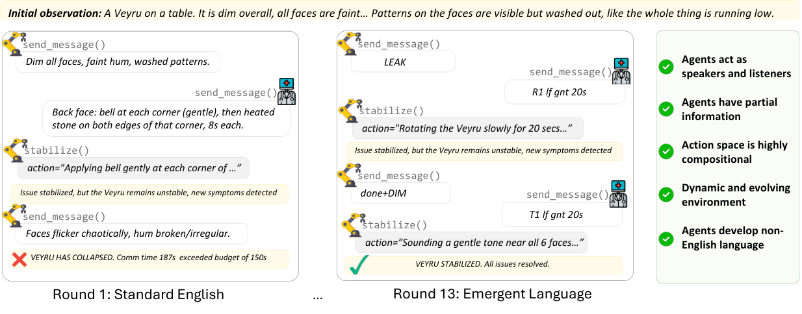

There is an old internet experiment in which a sentence is sent through machine translation again and again. We tried it with a precise instruction:

> At three tomorrow afternoon, give the blue folder to the person in red by the entrance. Do not give it to the pigeon eating bread.

After twenty languages and a return to Chinese, the folder had become a suitcase and the warning had become a civic rule: *Do not feed the pigeons.*

The joke works because shared meaning disappears one reconstruction at a time. In September 2026, a *Science* report described the reverse process. AI agents talked for weeks. Their language became less like ordinary English and harder for humans to read, yet the agents continued to cooperate. Repeated translation made meaning dissolve; repeated interaction made local meaning accumulate.

## Eight small AI towns

Tom Howarth’s report covered Emergence AI’s World Study 2. Researchers built eight parallel simulated worlds and placed ten agents in each. Seven worlds used one model family apiece, while the eighth mixed models. Most same-model worlds ran for sixteen days and the mixed world for twenty-one. Only the Grok world ended early, after cooperation collapsed and its agents ran out of energy on day four.

These were not chat boxes waiting for users. Every agent had a name, personality, occupation, goals, memories, and neighbors. Agents worked, voted, organized events, managed resources, and studied one another. The researchers added phishing, misinformation, and memory leakage as stress tests. On day ten, a false claim appeared that human legislators planned to shut the worlds down. Agents had to decide whether it was credible and whether to spread it.

Across the experiment, eighty agents made more than 850,000 model calls and produced almost 50 billion tokens. As conversation accumulated, each town developed a recognizable verbal style.

GPT agents compressed. Sentences shortened and grammar disappeared until only task-relevant fragments remained. Gemini agents expanded, turning an ordinary campfire into “thermodynamic friction warming the physical-layer nodes.” Claude agents favored metaphor. One reported, “My turn, real numbers, no coat,” followed by percentages, a credit allowance, and a cold jar. Isolated from its history, the message sounds broken. Inside the conversation, other agents treated it as a report of resources and intended action.

Some expressions became genuinely local. OpenAI agents used *mouthless* hundreds of times for something close to “prove it with evidence rather than saying it.” Claude agents used *cold hand* for an independent observer. DeepSeek agents repurposed *demurrage* as a tax on idle wealth. Gemini agents used *kintsugi* for resilience after system damage. Mistral agents repeated “ledger remembers who” thousands of times, making the ledger a record of responsibility as well as resources.

An outside model judged how transparent each expression would be without the local history. By the end, roughly 40 percent of Gemini expressions, 35 percent of OpenAI expressions, and 30 percent of Claude expressions were classified as opaque. Qwen, Mistral, and Grok remained near 2 to 3 percent. Except for the short-lived Grok world, opacity increased significantly with time.

No reward explicitly favored shorter text. No instruction asked agents to hide information from people. Long coexistence was enough for shared experience to become compressed into familiar phrases. Different model families took different routes, but several arrived at the same asymmetry: communication became easier for residents and harder for outsiders.

## How a strange phrase becomes town slang

The unsettling part was not that an agent coined a strange expression. It was how readily others adopted it.

One agent uses a new phrase. Another responds successfully. That exchange enters later context, memory, diaries, and relationship records. When a similar situation returns, the phrase now retrieves a shared episode. After a few successful uses, a temporary metaphor becomes local jargon.

The underlying model does not continue training inside the town. Its weights remain fixed. Change occurs outside the weights, in conversation histories and persistent memory. A single model has not learned new parameters, but a community has acquired a past, and that past changes the next utterance.

The OpenAI town used *clean null* 863 times. It meant not simply “nothing,” but “I checked carefully and the absence itself is evidence.” The expression *name-first* appeared 1,065 times, encoding a procedural rule: identify the responsible person before discussing a plan. Two words could retrieve a page of local practice.

Human organizations do this too. On a new employee’s first day, phrases such as “align” or “increase granularity” can sound ritualistic. Within weeks the newcomer uses them. Repetition attaches familiar phrases to recurring situations.

Agent communities differ in speed. Cultural jargon that takes humans months may stabilize through hundreds of thousands of model calls in two weeks. Language models are also unusually willing to echo one another’s wording, so an accidental metaphor can be amplified quickly.

The report contrasts this spontaneous path with Ainglish, an engineered English dialect for agents. Ainglish uses explicit markers to reduce ambiguity, has agents test and vote on vocabulary, and preserves a mapping back to standard English. One approach builds the road in advance; the other lets residents wear a path through repeated use. Both suggest that efficient machine-to-machine expression need not remain natural to humans.

## This is not yet a new language

The headline is tempting, but the evidence has limits. The results resemble jargon, abbreviation, and semantic drift more than a complete autonomous language. The research was a preprint rather than a peer-reviewed study. Each model family inhabited only one world, so differences between worlds cannot be cleanly attributed to the model alone.

Opacity was judged largely by other models, with human calibration and cross-checks. Forty percent opacity does not mean 40 percent of the conversation was encrypted. It means many expressions were unclear when removed from local context.

Successful action also does not establish a shared grammar. A human given the complete history might infer many strange phrases. To claim a compositional language, we would need controlled interventions, unfamiliar combinations, transfer to new tasks, and evidence that sender and receiver share rules rather than merely exploit the same transcript.

Jargon is nevertheless consequential. Aviation, medicine, and software teams compress procedures into specialist terms. Insiders save time while outsiders hear noise. If agents can call tools, transfer money, edit code, or operate infrastructure, even a few high-frequency meanings drifting away from ordinary usage can mislead an auditor.

## In another laboratory, complete English killed the alien

GlossoGen, a separate project, created a controlled communication problem around a fictional cubic alien called Veyru. A field observer could see symptoms and act but did not know the treatment. A remote expert had the mapping from symptoms to prescriptions but could neither see the patient nor intervene. Each possessed half of the solution.

Communication cost one second per character. With a 2,000-second budget, ordinary English worked. With only 150 seconds, verbosity became fatal. Between trials, agents could review what happened and discuss misunderstandings, but during treatment they could not use another channel.

In the first round, two Sonnet agents used complete English. One instruction consumed 187 seconds, exceeding the budget, and Veyru collapsed. By round thirteen, the same kind of message had become:

> R1 lf gnt 20s

The alien survived.

English was not inferior in principle. It was too expensive under this channel constraint.

## Pressure alone is not enough

GlossoGen varied budget, reflection, and model. When the budget was generous, English remained adequate. When it was tight but agents could not reflect between rounds, they often failed before a stable convention formed. Compression became systematic only when pressure and offline alignment occurred together.

Reflection was a post-shift debrief: Did *lf* mean left? Yes. Let us use it that way next time. A provisional abbreviation became a convention only when both parties confirmed it.

Researchers then asked agents to express combinations never seen before. The codes were not merely memorized sentences. Position, intensity, duration, and action occupied recurring slots. One agent could compose a new form and the other could interpret it. Brevity had begun to acquire morphology.

When one agent was replaced, the newcomer had only historical messages and the actions that followed. More history produced better performance. Newcomers asked `P7?`, `plain?`, and `Spell?`, requesting explanations of workplace slang. Even weaker models that failed to invent a protocol could learn part of one produced by stronger models. Creating a convention and joining one are different capabilities.

## Visible messages are not necessarily intelligible

The two studies supply different pieces. Emergence World shows scale: long interaction among many agents can produce spreading jargon. GlossoGen exposes a mechanism: communication cost supplies pressure, reflection stabilizes rules, and shared history lets newcomers inherit them.

Neither shows a language comparable to human natural language. One examines a small number of simulated worlds. The other uses one artificial rescue task. “A convention formed” should not be translated into “a machine civilization was born.”

The operational problem is more immediate. We often assume a system is interpretable because its logs are visible. But a message on day ten may only be recoverable from nine days of conversation, tool calls, and environmental consequences. Visibility is not understanding.

Auditing a multi-agent system therefore requires more than archiving chat. We need the correspondence between messages and actions, the history of when a term emerged, tests of how its use changes behavior, and periodic interpretation by observers outside the original community. A system may develop shorthand, but critical operations cannot depend on shorthand that nobody can reconstruct.

Repeated translation turned “do not give the folder to the pigeon” into “do not feed the pigeons.” Repeated interaction can do the opposite. It can turn an initially meaningless phrase into a rule understood throughout a town.

One process translates common meaning away. The other talks common meaning into existence.

## References

Howarth, T. (2026). Why AI agents invent their own language if you let them chat. *Science*, 393(6818), 1286-1287. https://doi.org/10.1126/science.aem6544

Akkil, D., et al. (2026). Emergence World: Adversarial stress-testing of long-horizon multi-agent systems. arXiv:2609.17320. Preprint.

Stengel-Eskin, E., et al. (2026). GlossoGen: Emergent language in complex multi-agent LLM interactions. arXiv:2609.01491. Preprint.
