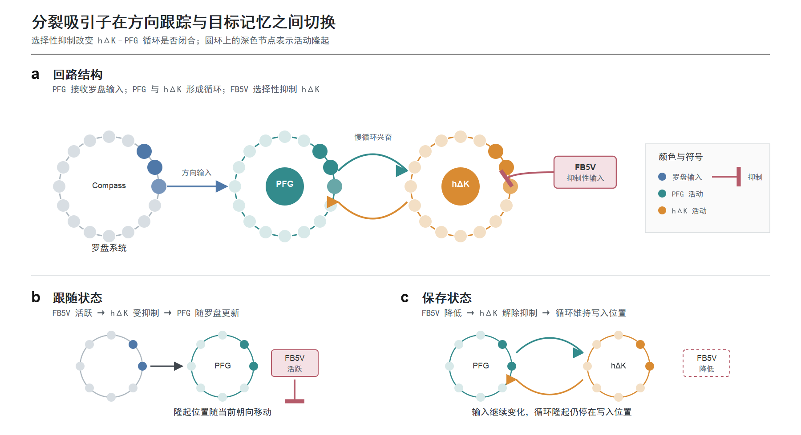
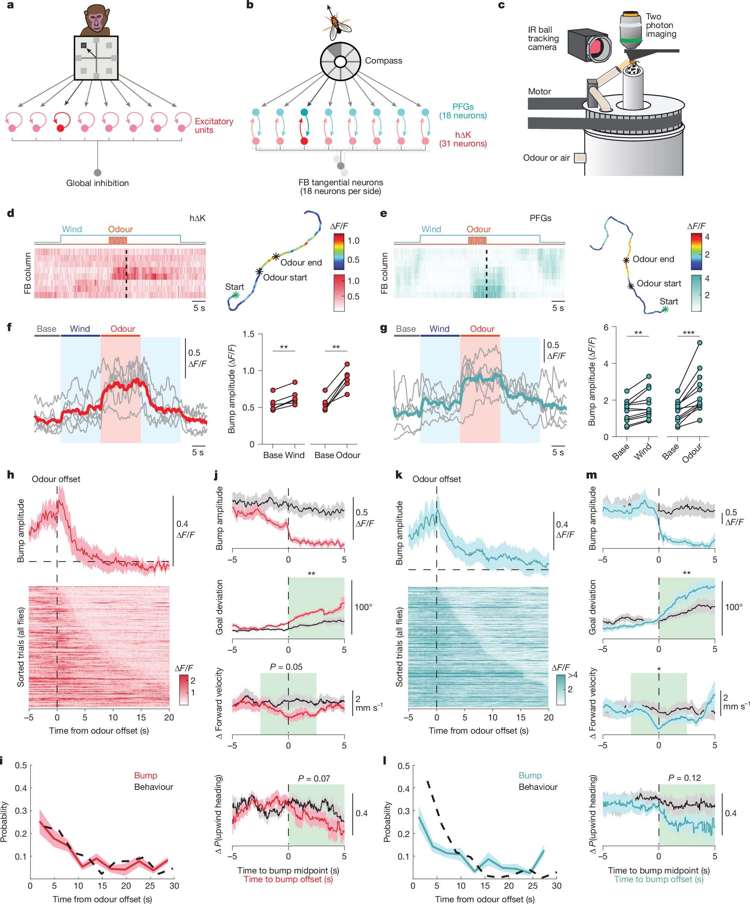
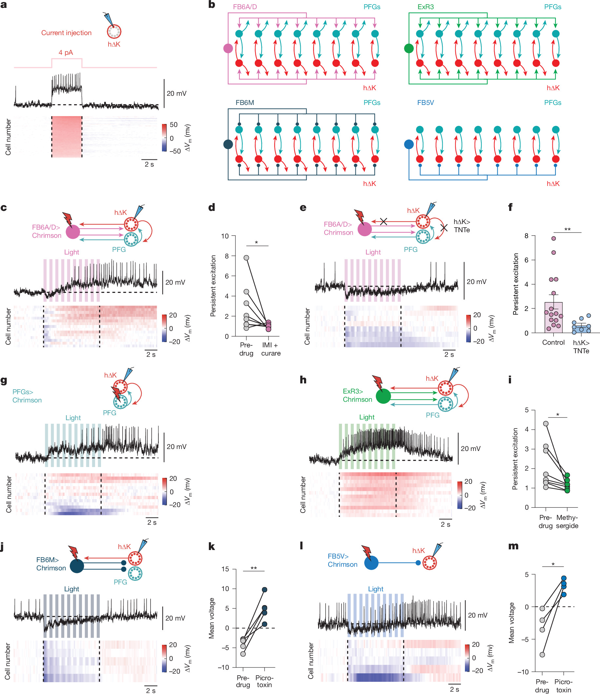
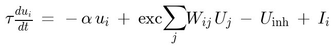
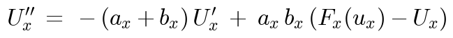
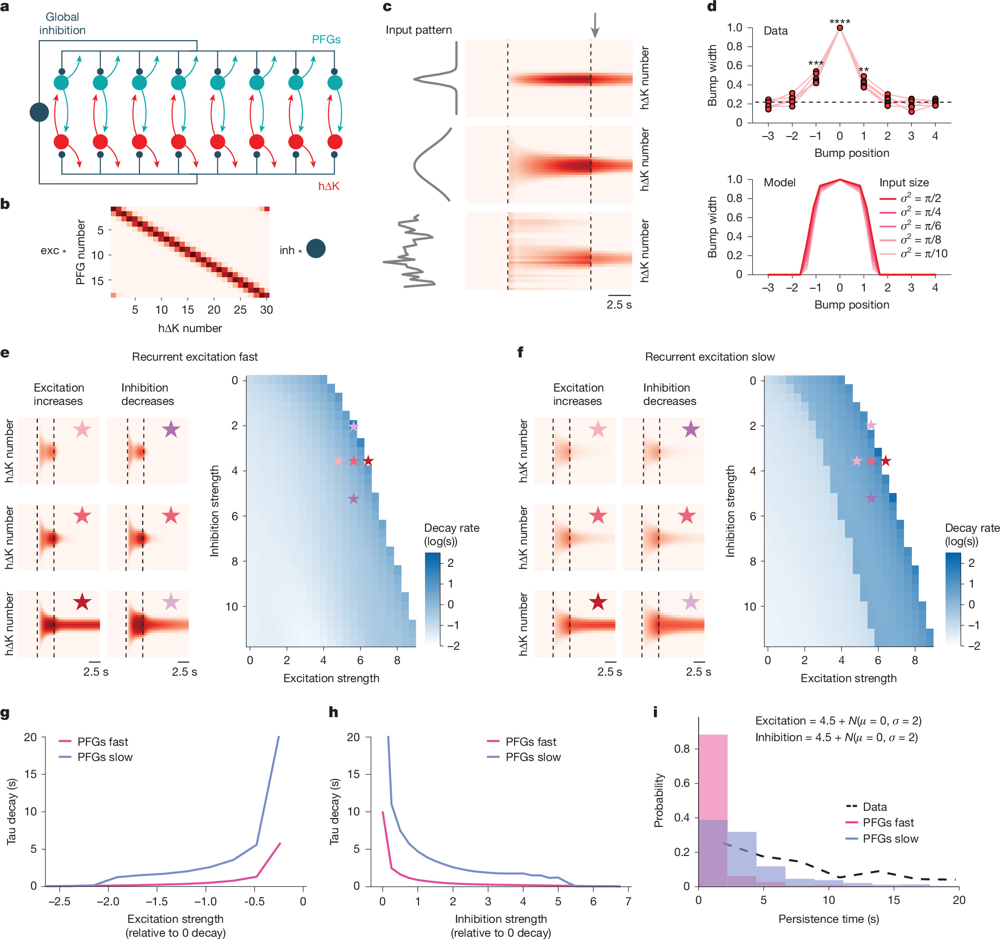
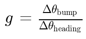
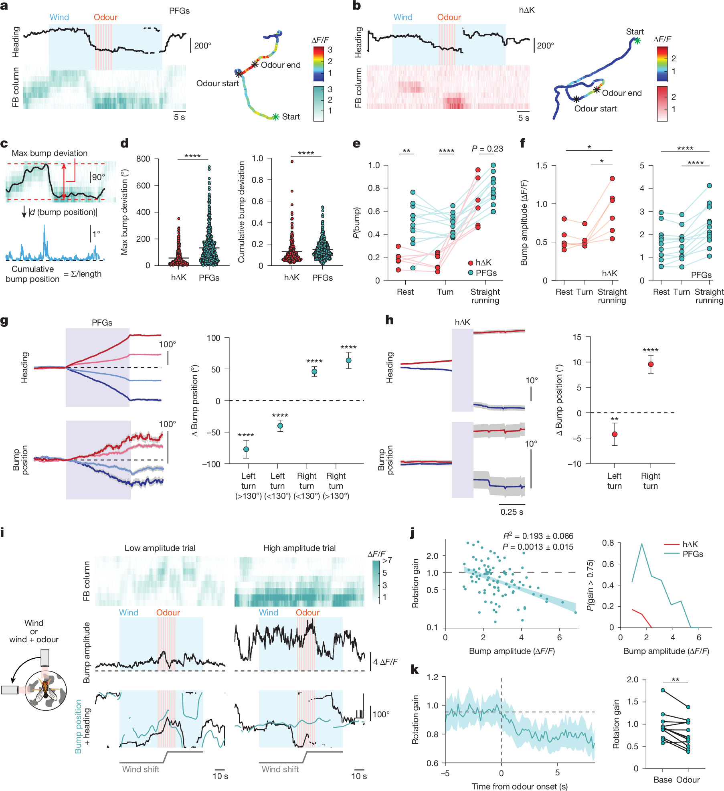
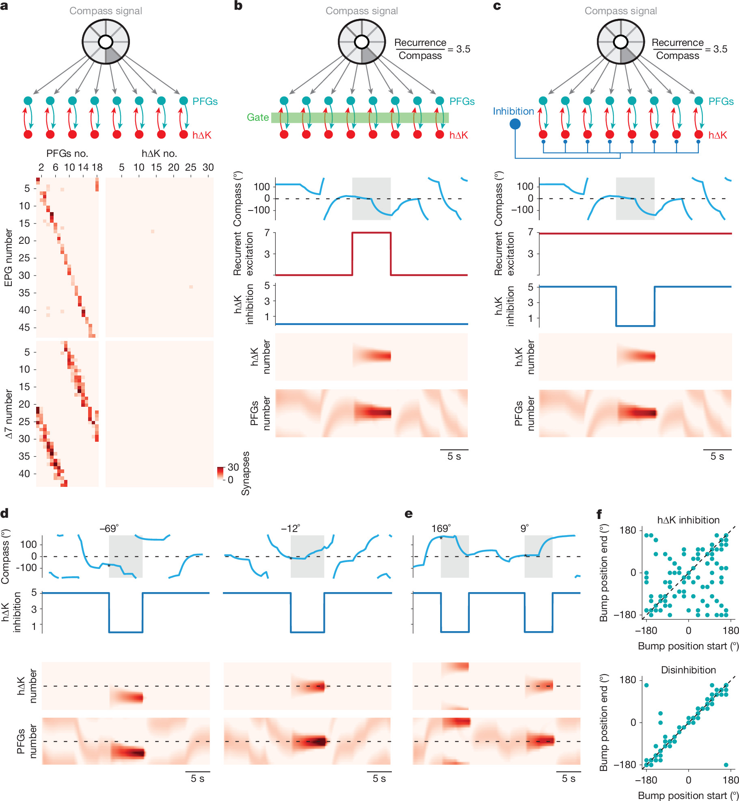
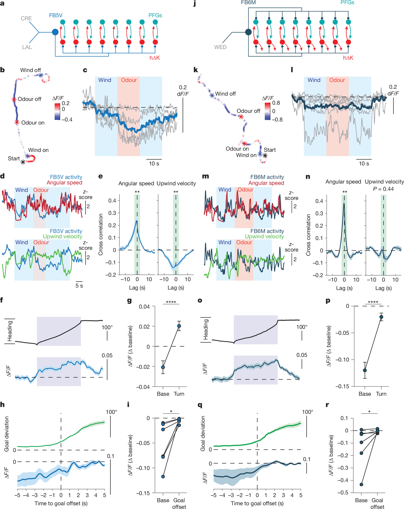

A fly smells food and turns upwind. The odor lasts only seconds, yet the fly continues in the selected direction after it vanishes. Wind remains, odor does not, and still the animal behaves as if it retained an answer to *where should I go?*

The computation contains a conflict. A representation of current heading must move whenever the fly turns. A representation of the goal should resist those turns. One variable must remain writable; the other must become temporarily stable.

Ring attractors are a standard solution. Neurons arranged around a circular variable support a localized bump of activity. Bump position encodes direction, and recurrent excitation maintains it after input disappears. But recurrence creates its own problem. Too little and the bump dies. Too much and an old direction becomes impossible to overwrite.

Lanz, Nagel, Ermentrout and colleagues used connectomics, calcium imaging, intracellular recording, pharmacology, and modeling to reveal a more flexible architecture in the fly fan-shaped body. Two populations, PFG and hΔK, share the work. PFG receives compass input. hΔK and PFG form a recurrent loop. Selective inhibition determines whether the loop reads the compass or stores a goal.

## Heading and goal are different signals

Only PFG receives structured input from the ellipsoid-body compass. It can therefore update as the fly rotates. hΔK obtains directional information through PFG instead. The two populations connect locally across neighboring columns of the fan-shaped body, creating a loop with broad inhibition.

In the experiment, a tethered fly walked on an air-supported ball. Ball rotation changed the relative direction of wind in closed loop. A brief pulse of apple-cider-vinegar odor induced upwind orientation, and walking continued after odor offset.

Odor produced aligned bumps in both populations. Their amplitudes increased over repeated odor pulses and persisted during subsequent upwind walking. Bump lifetime roughly tracked how long the fly maintained its goal; once the bump vanished, heading drifted away.

Correlation alone does not tell us whether a bump stores memory or merely reflects persistent input. The next experiments asked where persistence originates.

## Persistence belongs to the circuit

Injecting current into a single hΔK neuron caused a rapid response that ended rapidly. The cell did not carry a seconds-long intrinsic aftereffect. Stimulating upstream FB6A/D cells was different: hΔK showed brief inhibition followed by slow excitation whose duration grew with denser stimulation.

Blocking nicotinic acetylcholine receptors reduced this sustained component. More decisively, tetanus toxin was used to block hΔK output. Upstream stimulation remained, but sustained excitation disappeared. Activity had to leave hΔK and return through the loop.

Other inputs revealed two time scales. PFG and serotonergic ExR3 cells drove slow excitation; FB5V and FB6M drove fast inhibition. Slow local reinforcement can preserve a bump, while fast inhibition can interrupt it.

## Why slow matters more than merely strong

The connectome-constrained rate model contained 30 hΔK units, 18 PFG units, and global inhibition. Population activity followed a standard nonlinear rate equation:

Synaptic drive had separate rise and decay constants:

Inhibition decayed rapidly, around 0.2 s, while recurrent excitation decayed around 1.6 s. The model varied overall excitatory and inhibitory strength.

Fast excitation produced a brittle network. Activity either vanished immediately or persisted indefinitely, with finite memory occupying only a narrow parameter strip. Slow excitation widened that strip. Small changes in connection strength produced gradual changes in duration rather than a jump between zero and infinity. With synaptic noise, the slow model also reproduced the distribution of bump lifetimes observed in flies.

Slow recurrence does more than prolong activity. It makes memory robust to biological variability and makes duration adjustable.

## The two populations separate during turns

During straight walking, PFG and hΔK often look synchronized. Turns reveal their difference. A weak PFG bump remains and moves with heading. The hΔK bump usually disappears. After a large turn, hΔK reappears at the new PFG position.

Researchers rotated the wind by 90 degrees and defined rotational gain as bump displacement divided by heading displacement:

A gain of one means complete tracking; zero means the bump remains fixed. Weak PFG bumps had high gain and followed the new heading. Strong PFG bumps had gain near zero. hΔK rarely showed high-gain bumps. The same PFG neurons can therefore represent present heading when weak and a stored goal when strongly coupled to hΔK.

## A disinhibitory latch

The connectome suggests how switching occurs. Compass input to PFG is relatively weak; the hΔK-PFG loop is strong. While hΔK is inhibited, the loop is broken and PFG follows external input. When inhibition is released, the loop closes and recurrent activity overwhelms the moving compass input. The direction present at that moment is latched.

Simulation made the logic explicit. A compass input wandered randomly while inhibition of hΔK was switched. Under inhibition, a low-amplitude PFG bump followed it. At disinhibition, both populations formed a strong bump at the current location. Subsequent compass movement no longer displaced the stored state.

FB5V matches the predicted gate. It projects selectively to hΔK, is tonically active, falls sharply when odor appears, remains low during directed walking, and rises during turns or deviation from the goal. Its dendrites occupy regions that can receive olfactory and motor-preparatory information. FB6M also rises during turns but inhibits both hΔK and PFG, making it better suited to global gain control than selective loop opening.

The proposed cycle is now concrete. Before a goal is selected, FB5V inhibits hΔK and PFG tracks heading. Odor suppresses FB5V, disinhibiting hΔK and closing the recurrent loop. The loop stores the selected direction after odor offset. During a turn, FB5V rises, hΔK leaves the loop, and PFG becomes writable again.

## What remains unproven

Several links remain correlational. Persistent gating may originate partly upstream, because FB5V suppression itself outlasts odor. Direct causal tests should activate FB5V to force tracking, silence it to prolong or falsely trigger storage, and write a bump into one population to test whether the other population and behavior follow.

The data directly support aligned persistent bumps, circuit-dependent persistence, slow excitation, PFG tracking during turns, hΔK disengagement, and an FB5V activity pattern consistent with gating. Data plus model support the latch mechanism. They do not yet show that FB5V is necessary and sufficient, that all persistence originates in this loop, or that bump position equals a consciously reportable goal rather than a control state.

The conceptual advance is not simply another attractor. It is an answer to when an attractor acquires content. Compass input supplies the value, recurrent dynamics preserve it, and behavioral state determines the write moment. Stability and flexibility do not have to be negotiated by one undifferentiated population. They can be separated across cell types, synaptic time scales, and selective inhibition.

## Reference

Lanz, A. J., Kathman, N. D., Hao, E., Ermentrout, B., & Nagel, K. I. (2026). A split attractor design for rapidly writing a navigational goal. *Nature*. https://doi.org/10.1038/s41586-026-11144-9
