When people freely recall a list, recall is not free of order. An item often brings back a neighbor, and the next item is more likely to come from just after than just before it. This temporal contiguity has usually been explained by a drifting context: items studied close together share similar context, so retrieving one reinstates cues for its neighbors.

But the same recall sequence can come from another mechanism. A system can explicitly encode first, second, third, and use position as an address. Both accounts may produce ordered recall while making different predictions about internal trajectories and generalization.

A modeling study trained hundreds of memory-augmented recurrent networks without rewarding any particular recall order. The only goal was to remember as many items as possible. Three strategies emerged.

## Store a state, then query it

During encoding, eight items were shown sequentially. A GRU updated its hidden state and wrote a representation into an external memory slot. After a distractor, the model repeatedly queried those slots and selected an unrecalled item.

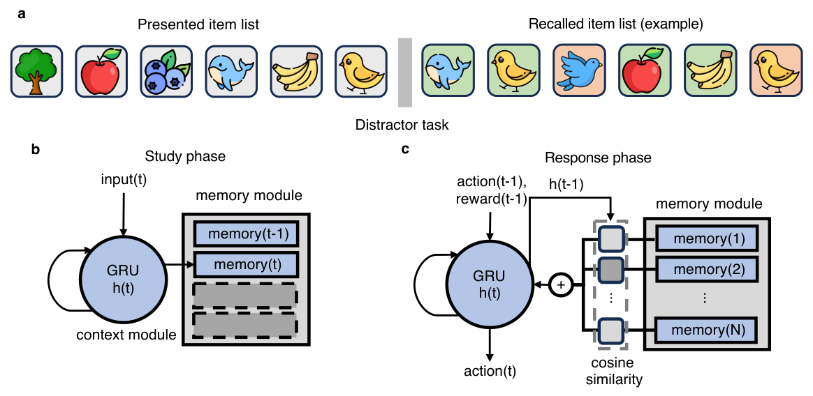

Temporal context and position coding predict different lag conditional-response curves. A drifting context predicts a smooth gradient around lag zero, usually with a forward asymmetry. A position code can create a sharp spike at +1. Their hidden states also differ. Context trajectories depend on list contents; a position code can reuse nearly the same trajectory across lists.

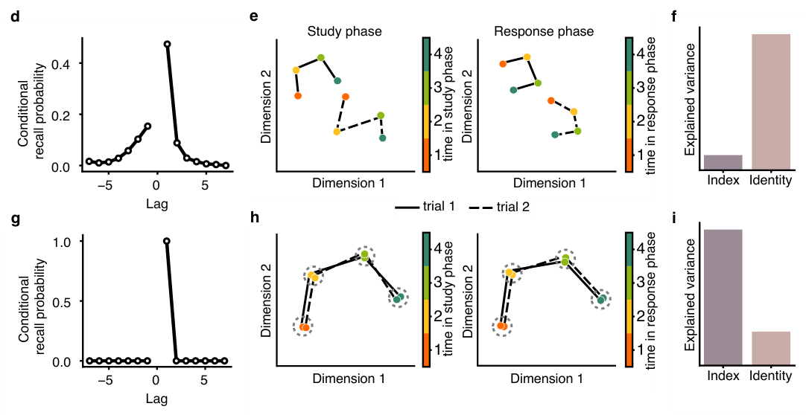

The controller state \(h_t\) was updated recurrently and written into memory with the item. During recall, the current state generated a query; attention over stored slots retrieved candidate content. Training used discounted reward for correct unrepeated recalls. It never instructed the network to recall forward, backward, or by position.

## Three solutions to one objective

Across 405 trained networks, behavior and representation clustered into three groups.

The first resembled forward temporal context models. Its lag curve was smooth and biased toward positive lags. Hidden trajectories varied across lists because they carried item-dependent context.

The second resembled backward context retrieval. Its curve favored negative lags, as if recall reinstated a state leading toward earlier neighbors.

The third showed an unusually sharp +1 transition. Hidden-state trajectories overlapped across lists and strongly encoded ordinal position. The authors call this a memory-palace strategy: a reusable sequence of internal locations is built, and different items are placed into those locations.

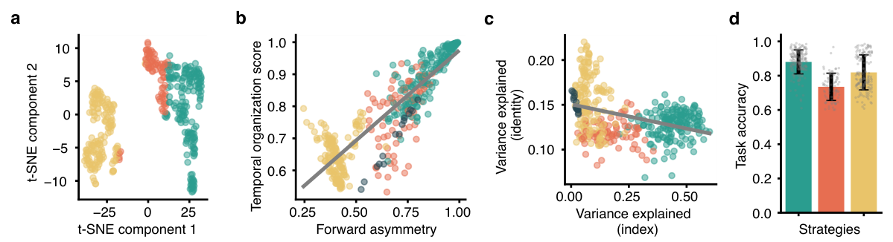

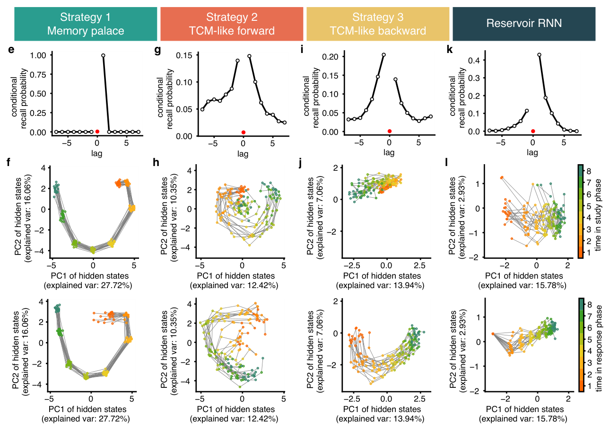

All groups retained item identity. The difference was not whether content was stored, but what organized access to it. In position-code networks, ordinal position explained more hidden-state variance and could be decoded across lists and across encoding and recall. In context-like networks, state depended more strongly on content and local history.

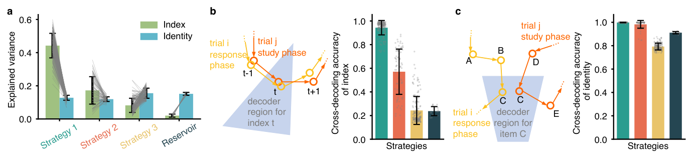

## When is a memory palace worth building?

The training environment determines which solution pays.

Discounting favors earlier rewards. When receiving a correct item sooner is valuable, a reliable forward traversal becomes attractive. More importantly, the study manipulated how much controller state survived between encoding and recall. If working memory was fully preserved, backward temporal-context strategies dominated. If it was completely cleared, almost every network built the position-code strategy. A reusable ordinal scaffold compensated for the loss of episode-specific controller state.

Across networks, variance explained by ordinal position correlated strongly with both forward asymmetry and temporal organization, r(403)=.87. These correlations show that representation and retrieval order covary, but the intervention on state retention supplies the more informative causal lever.

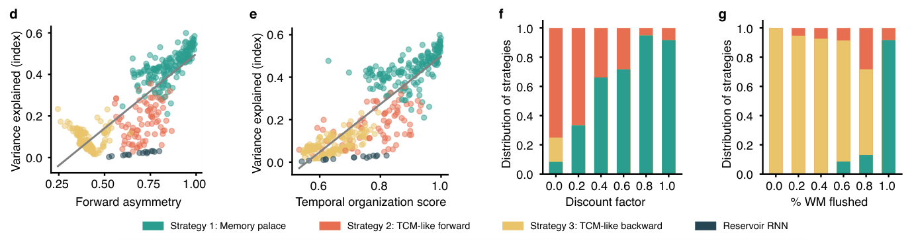

Position coding also brought robustness. Under moderate test noise, memory-palace networks often outperformed context-like networks. Training with more noise increased the proportion that discovered a memory palace. At very high noise, an idealized forward context strategy could catch up or surpass it.

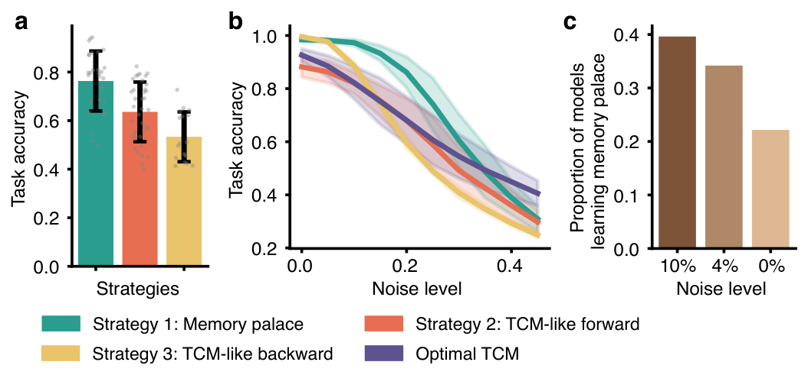

This gives the metaphor a precise computational meaning. A memory palace is not simply a vivid mnemonic image. It is an internal trajectory that is stable across episodes and can be used as an address system when transient context is unreliable.

## Human behavior matches shape, not mechanism

The researchers searched the PEERS free-recall dataset for people whose lag curves resembled the learned strategies. Some participants showed a +1 spike, others smooth forward gradients, and others backward gradients.

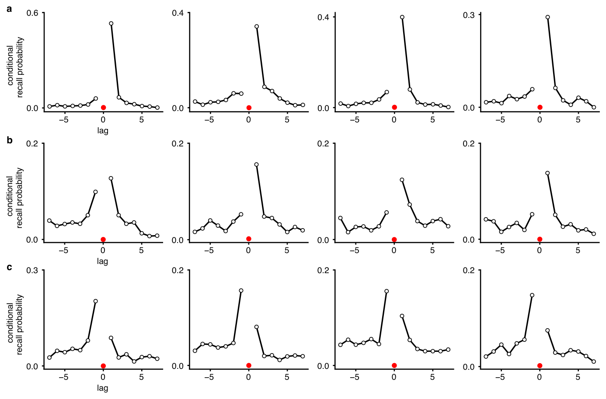

Human temporal organization and forward asymmetry were positively related to recall performance, but weakly, around r=.22 and r=.15. The model correlations were much stronger. Behavioral resemblance does not demonstrate that a human uses the same hidden code as a network.

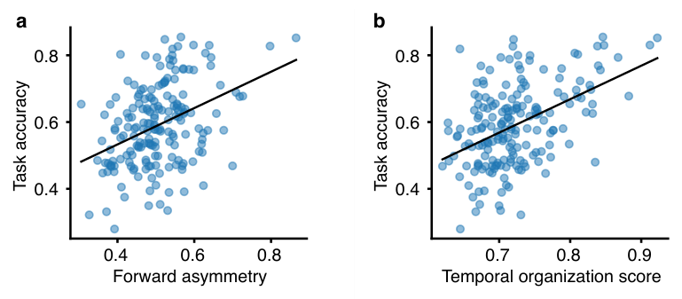

To identify mechanism in people, one would need a representational signature, a selective perturbation, or transfer test. A position strategy should generalize ordinal structure across lists and be selectively resilient when episode-specific context is disrupted. A temporal-context strategy should remain sensitive to slowly changing external context.

## External context and conditional recall

The authors added a slowly drifting external context vector. As its strength increased, lag curves flattened, ordinal decoding weakened, and fewer networks adopted the memory palace. A reliable contextual signal reduces the need to construct an internal position sequence.

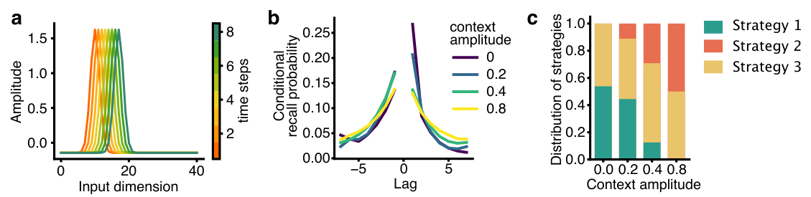

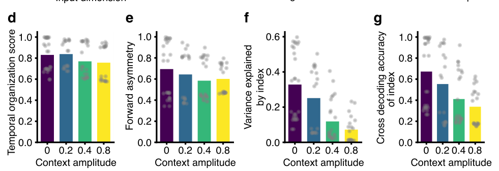

A second manipulation changed the task. In conditional free recall, only items belonging to a cued category counted. Simple serial traversal is inefficient because irrelevant positions must be skipped. Networks trained for conditional recall developed smoother lag curves, content-dependent state trajectories, and stronger identity than ordinal representations. All five tested networks fell on the temporal-context side.

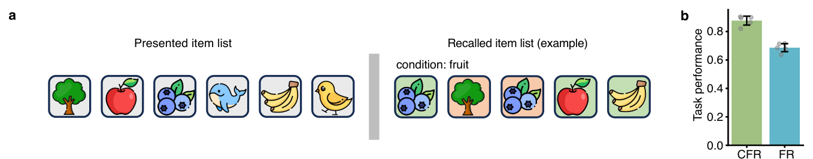

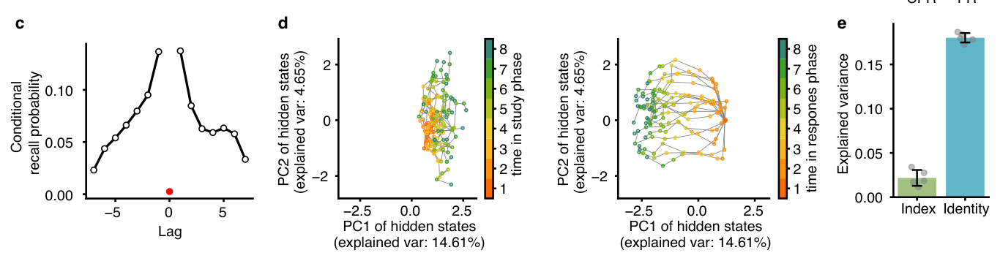

## Strategy is an adaptation to the bottleneck

The key result is not that one memory theory wins. Identical architecture and reward can discover qualitatively different algorithms. What changes the strategy is the information bottleneck: whether internal state survives, whether context drifts reliably, how noise enters, and whether retrieval must respect semantic conditions.

That lesson matters for both cognitive modeling and AI. Matching a human lag curve is insufficient if many internal algorithms generate it. A model becomes explanatory when experimental manipulations predicted from its representation distinguish it from alternatives.

The study turns an old debate into a design problem. Sequence can arise because adjacent memories share context, because retrieval walks backward through a trajectory, or because a reusable ordinal scaffold supplies addresses. The order we observe is an outcome. The mechanism is the way a system solves the constraints it was given.

## Reference

The article is based on the 2026 neural-network study of emergent retrieval strategies in free recall and the PEERS behavioral comparison reported with it.
