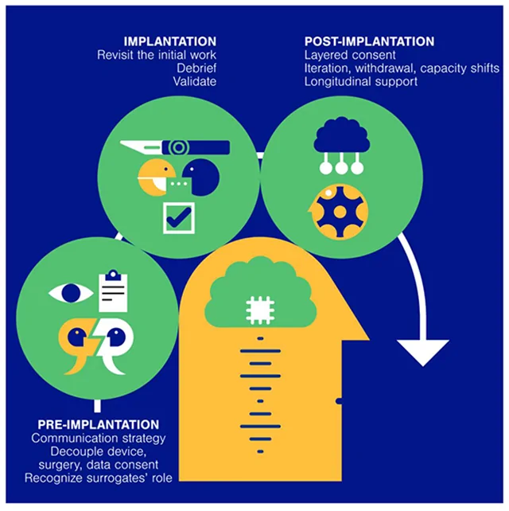

Sometimes an informed consent conversation proceeds one letter at a time. A care partner recites the alphabet, and a candidate looks upward to say yes. The answer is assembled slowly because the person considering an implanted brain-computer interface, or iBCI, may already have lost speech and hand movement. A consent form arrives, but the person can no longer sign it.

This is not a peripheral problem. Communication is often the function the implant is meant to restore. Language BCIs can already turn neural activity into sentences, and motor BCIs can control cursors or robotic arms in clinical studies. Yet each team still tends to construct its own consent process around a technology that combines neurosurgery, continuously collected neural data, adaptive decoders, and software whose capabilities change after implantation.

A 2026 paper in *Device*, written through the Implantable Brain Computer Interface Collaborative Community, proposes a common framework. Its central move is simple but consequential: consent should no longer be treated as a document signed before surgery. It should become a process that runs through the device’s whole life.

## Where the one-time model fails

Traditional medical consent is suited to a bounded procedure. The clinician explains an intervention, its risks, alternatives, and expected benefit. The patient decides, signs, and the decision enters the record.

An iBCI is not bounded in this way. Implantation happens once, but the device may become the user’s principal channel for expression and independent action. Its decoder changes with training. Its software acquires functions. Its performance changes with the user’s condition and environment. Neural recordings continue to accumulate, and data collected for care may later support research or commercial development.

This creates a distinctive form of pressure. A person with a progressive disease and no restorative treatment may see an iBCI as one of few remaining options. Hope can make a nominally voluntary decision less free. Fragmented local standards also make it easy to omit a risk or bury a consequential choice inside a long form.

## Three periods, with modular choices

The framework spreads consent across three periods: before implantation, around implantation, and after implantation. Each contains practical prompts linked to ethical commitments. It supplements rather than replaces existing research, medical, and data-protection rules.

The framework uses the neutral term *iBCI user* because the same person may be a research participant during a trial and a patient after approval. It is modular in another sense too. Some candidates can hold an ordinary conversation. Some communicate through eye movements. Some have no reliable outward behavior. Communication ability changes how consent is obtained and verified, but it should not silently determine eligibility.

## Before implantation: validate the channel first

For a candidate who cannot speak, the first question is not yet whether they agree. It is how they can express agreement, and how reliable that channel is.

The method may be an eye tracker, an assistive keyboard, a yes or no eye movement, or partner-assisted scanning in which letters are presented serially. The channel should be documented. A speech and language therapist may need to help. Teach-back can test whether information was understood. Error rates, test-retest reliability, and a procedure for resolving ambiguous answers are not engineering trivia; they determine what decisions the channel can support.

Assessment must go beyond asking whether the person is conscious. It should address cognition, understanding, and psychological state in ways adapted to the available response channel. Earlier work on communication BCIs for locked-in syndrome recommends iterative disclosure, validation with questions whose answers are known, independent observation when needed, and repeated unambiguous assent before a legal representative signs.

For a person with no observable response, task-based EEG or functional imaging may reveal covert consciousness or cognitive motor dissociation. Such evidence is easy to overinterpret. The framework calls for validated paradigms, transparent criteria fixed in advance, and consensus procedures where they exist. Both errors matter: declaring an aware person unaware, and attributing awareness where evidence does not support it.

Progressive disease makes advance preferences especially important. Candidates should record iBCI-specific directives while they can. A surrogate should use substituted judgment, anchoring a decision in the person’s known values rather than the surrogate’s hopes or fears. A surrogate’s earlier decision can later be revisited if the implant restores a reliable means of expression.

## One package should become three conversations

The framework separates consent for the operation, the device, and the neural data.

Neurosurgical implantation has one set of risks. Device maintenance, failure, and long-term support have another. Neural data create questions about collection, storage, access, secondary use, ownership, and whether a trained decoder is itself something the user can control or transfer. A person might accept an implant while declining a particular data-sharing route. Refusing one module should not automatically cancel all the others.

This separation matters because high-resolution neural recordings may support unusually intimate inferences. The current population of iBCI users is very small, which can make re-identification easier rather than harder. Electrode type and placement also determine what future analyses might extract from recordings whose significance is not yet understood.

## Four neglected questions

First, expectations must be concrete. Can the system operate only during laboratory sessions, or at home without an engineer? Does it require broadband, frequent calibration, or a caregiver? Will it work during travel or hospitalization? What does the implant mean for MRI access, airport security, bathing, charging, or care of a percutaneous connector?

For a progressive disorder, a newly gained ability may later decline or disappear. That possible second loss, and the psychological support surrounding it, belongs in the conversation before implantation.

Second, someone must pay for surgery, maintenance, repair, support, and possible removal. What happens if a sponsor withdraws or a company dissolves? Research compensation must not exert undue influence. Financial assistance that improves access must remain transparent and distinct from an inducement to accept the device.

Third, foreseeable secondary uses of neural data should be stated plainly: algorithm development, commercial products, or external databases. Receiving a device should not require blanket acceptance of every downstream use. The same separation applies to publicity. Early users attract media attention, but promotional participation must remain voluntary and revocable.

Fourth, ownership and portability cannot be postponed. Who controls the hardware, raw recordings, and decoder? What moves with the user when they change hospital, system, or sponsor? Benefit sharing is difficult because an individual contribution to a model trained on collective data is hard to isolate. That difficulty is not a reason to hide the issue inside an end-user license agreement.

## Around implantation: the last chance to change course

The peri-implantation period deserves its own checkpoint. Immediately before surgery, the candidate should have a final opportunity to withdraw. The decision and full consent record should enter the hospital’s electronic record. A prominent alert can preserve essential facts across teams: device identity and configuration, MRI conditions, removal risks, data-sharing preferences, and the status of a legal representative.

After surgery, the team should explain what occurred, including unexpected events, restate operating restrictions, and provide continuous clinical and technical contacts. Consent fails if the document exists but the knowledge does not travel with the patient.

## After implantation: can the BCI confirm its own use?

If the implant creates a communication channel, it may allow the user to confirm ongoing consent. The possibility is powerful and circular. The system under evaluation becomes the instrument through which the user evaluates participation.

Reliability therefore has to be graded. Calibration, error rates, and thresholds should be documented. A binary channel performing reliably above chance might support a low-risk, reversible choice. It should not automatically carry a complex request about medical goals. High-stakes decisions require richer output, strong test-retest reliability, independent confirmation, and perhaps a neutral observer or ethics consultation when uncertainty remains.

The record should say how the channel was tested, its known error rate, what decisions it can support, and when another channel is required.

## Withdrawal is not one action

New functions, data uses, or newly discovered privacy and cybersecurity risks may change a user’s willingness to continue. The paper proposes amendments revisited at defined intervals or milestones. Refusing an amendment must not be interpreted as punishment or automatic exclusion.

Withdrawal has layers. A user may disable a feature, stop transmitting data, keep data locally, leave a study while continuing clinical use, or request explantation. Removal may be risky, inaccessible, or impossible. Leaving hardware in place still creates maintenance and security obligations. Each route needs its own clinical and psychological support.

## A checklist is only a beginning

The authors are explicit that a framework does not guarantee adoption. Consent interventions often fail because they consume time, require unavailable expertise, or do not fit workflows. Implementation needs local advocates, role-specific training, templates, integration with review and documentation systems, monitoring, and feedback.

There is also a regulatory tension. Requirements far beyond those for comparable neural devices might slow useful innovation. The aim is proportional consistency, not maximal paperwork.

The deepest issue is that an iBCI can alter the channel on which consent depends. Once the machine becomes a condition of saying *yes*, consent can no longer remain a single event that happened before the machine existed. It must be designed, tested, and maintained as carefully as the interface itself.

## References

Young, M. J., et al. (2026). Unifying consent standards for implantable brain-computer interfaces. *Device*, 101271. https://doi.org/10.1016/j.device.2026.101271

Vansteensel, M. J., et al. (2022). Methodological recommendations for studies on the daily life implementation of implantable communication brain-computer interfaces for individuals with locked-in syndrome. *Neurorehabilitation and Neural Repair*, 36, 666-677.
