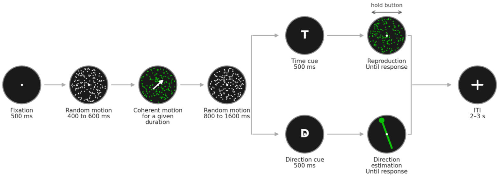
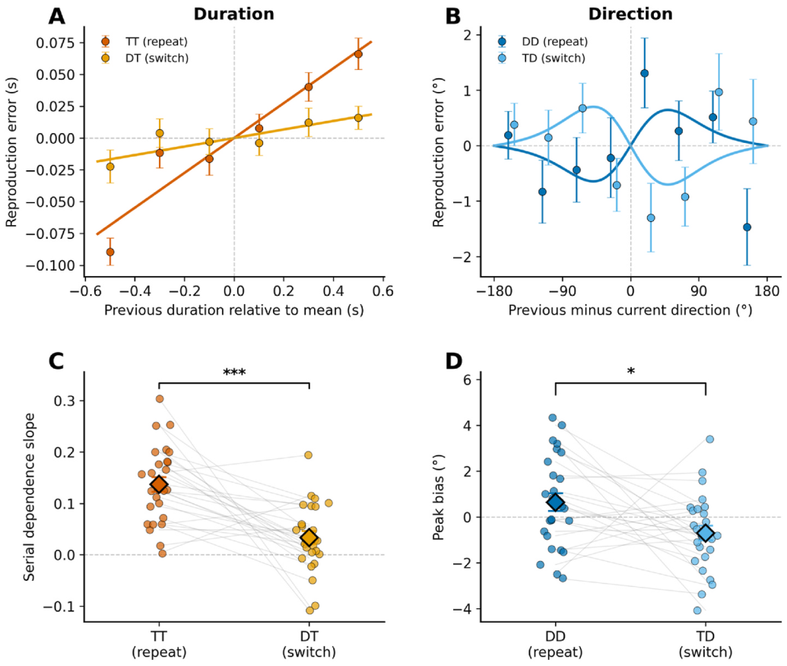
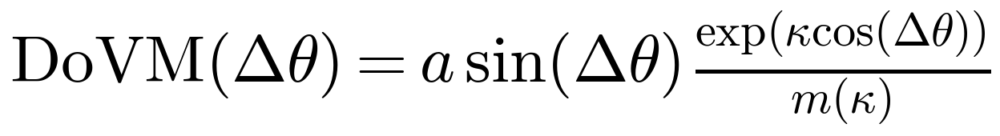
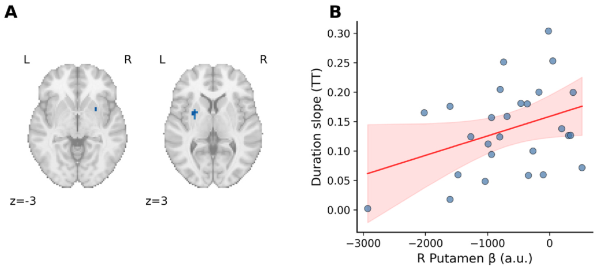

A moving-dot display appears briefly, and you reproduce how long it lasted. A reliable pattern emerges: the current error is positively related to the duration shown one trial earlier. After a relatively long stimulus, the next duration is reproduced as slightly longer. This attraction occurs even though stimuli are independent and participants report only the current one. It is serial dependence in time.

The behavioral effect is clear, but its neural basis has been harder to locate. For orientation and motion direction, fMRI studies suggest that population activity in early visual cortex is repelled from the preceding stimulus, while a downstream readout converts that repulsion into attractive behavior. Duration may be different. Earlier imaging work located information about previous duration in the caudate and hippocampus, structures associated more closely with memory than early sensory coding.

A 2026 study in *NeuroImage: Reports* tested duration and direction within the same stimulus. Twenty-seven participants viewed moving dots in the scanner. Only after the stimulus disappeared did a retro-cue tell them whether to reproduce its duration or direction. Longer previous durations produced weaker cue-evoked responses in bilateral putamen. This was the only previous-stimulus effect that survived whole-brain correction. No corresponding modulation was detected in V1, MT/V5, or the direction analysis.

The result identifies activity in the putamen during the cue period. It does not show that the putamen stores the preceding duration.

## Why measure duration and direction together?

Serial dependence across different features is often attributed to a common mechanism, but the behavior is not uniform. Duration judgments are usually attracted toward the preceding duration, whereas motion-direction judgments can be repelled from the preceding direction. Presenting both features in the same display asks whether these histories converge on the same neural system.

Each stimulus lasted between 0.8 and 1.8 seconds and moved in one of 16 directions. Because the retro-cue appeared only after the second mask, both features had to be retained. Participants reproduced duration by holding a key and direction by rotating a line. The four task transitions were time repetition (TT), direction-to-time switching (DT), direction repetition (DD), and time-to-direction switching (TD). The final analysis included 27 participants and 480 experimental trials.

## Behavior: a fourfold duration difference

When the time task repeated, the regression slope for previous duration was 0.13. After switching from direction to time, it was only 0.03, a roughly fourfold difference, (F(1,26)=22.49), (p<.001). A slope of 0.13 means that 13 percent of the previous duration's deviation from the mean carried into the current reproduction.

The direction effect was smaller and reversed with task transition. Direction repetition produced an attraction of (+0.64^\circ), whereas switching from time to direction produced a repulsion of (-0.70^\circ). The difference was (1.35^\circ), (p=.018). Relative to each response distribution, the direction effect was about 6 percent of error variability and the duration effect about 24 percent.

## Measuring a circular bias

Direction is circular: 0 and 360 degrees refer to the same point. The study wrapped the difference between consecutive directions to (±180^\circ) and fitted attraction or repulsion with the derivative of a von Mises function:

The amplitude (a) measures bias strength and (kappa) controls width. Individual effects were too small to estimate both parameters reliably, so the authors estimated a shared (kappa) from all trials and then fitted amplitudes for each participant. The reversal remained under alternative widths and when signed errors were compared without curve fitting.

## Separating history from switching

The fMRI model separated stimulus presentation, retro-cue, and response. At the cue, TT, DT, DD, and TD transitions were modeled independently. Previous duration entered only time-cued trials, and previous direction only direction-cued trials. This allowed stimulus history and task switching to be estimated in the same model.

Group results were corrected across the whole brain with TFCE-FWE at (p<.05). Eleven predefined regions covered timing, visual, and executive systems. Current duration produced duration-sensitive activity in occipitotemporal areas, confirming that the data were responsive to time. The critical test concerned the preceding duration during the next cue.

## Negative modulation in the putamen

Previous duration produced two significant clusters after whole-brain correction, both in the putamen and both negative. The left reached (p_{FWE}=.021), the right (p_{FWE}=.041). The longer the preceding stimulus, the weaker the cue-evoked response. A predefined right-putamen analysis showed the same direction, (d=-0.81), (p_{FDR}=.005). Its correlation with behavioral serial dependence was (r=.37), but did not reach significance, (p=.060).

Motor output is an obvious confound because duration was reproduced by holding a key and the putamen contributes to movement. Adding current and previous keypress duration left the effect almost unchanged. Participant-level estimates correlated at (r=.99), and previous keypress duration did not explain right-putamen activity.

No reliable previous-direction modulation or task-switching effect appeared in the putamen. These null results do not prove that duration and direction use separate mechanisms because the behavioral direction bias was only about one degree. The study establishes a narrower point: information related to previous duration was measurable in bilateral putamen and decreased as that duration increased.

## What remains unresolved

Duration serial dependence weakened after a task switch, yet putamen modulation did not show a reliable repetition-by-switch difference. Switching changed the reported feature, response procedure, and motor demand together, so the experiment cannot determine which change weakened history dependence.

The negative signal should not yet be called a duration memory. It could reflect a retained trace, adaptation, or a change in timing state. A stronger test would ask whether previous duration can be decoded from putamen activity and whether putamen connectivity with frontoparietal control regions changes across task transitions.

The safest conclusion is that previous duration leaves a measurable signal in the putamen. How that signal becomes the next judgment remains open.

## References

Cheng, S., Chen, S., Wu, J., Qu, C., & Shi, Z. (2026). Neural substrates of duration serial dependence: Putamen suppression of the prior duration trace. *NeuroImage: Reports*, 6, 100414.

Cheng, S., Chen, S., & Shi, Z. (2024). Opposing sequential biases in direction and time reproduction. *British Journal of Psychology*, 115, 825-842.

Fischer, J., & Whitney, D. (2014). Serial dependence in visual perception. *Nature Neuroscience*, 17, 738-743.

John-Saaltink, E. S., Kok, P., Lau, H. C., & de Lange, F. P. (2016). Serial dependence in perceptual decisions is reflected in primary visual cortex. *Journal of Neuroscience*, 36, 6186-6192.

Sheehan, T. C., & Serences, J. T. (2022). Attractive serial dependence overcomes repulsive neuronal adaptation. *PLoS Biology*, 20, e3001711.
