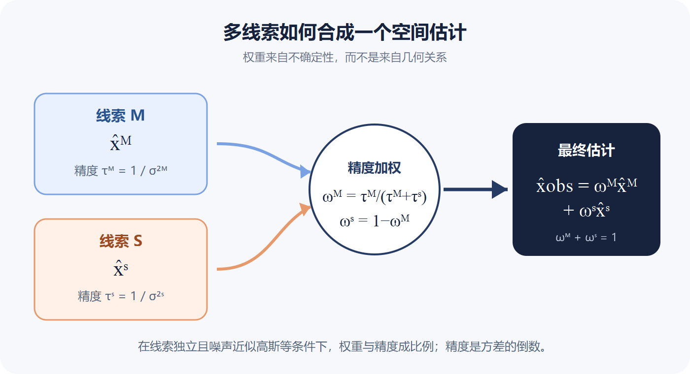
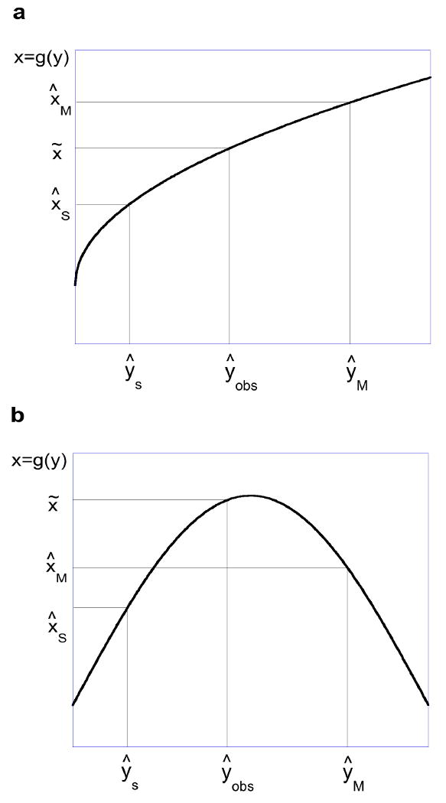
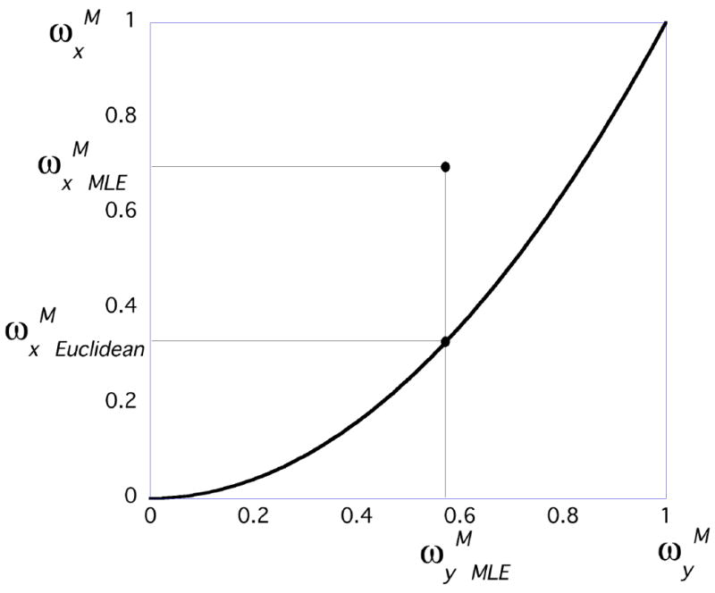
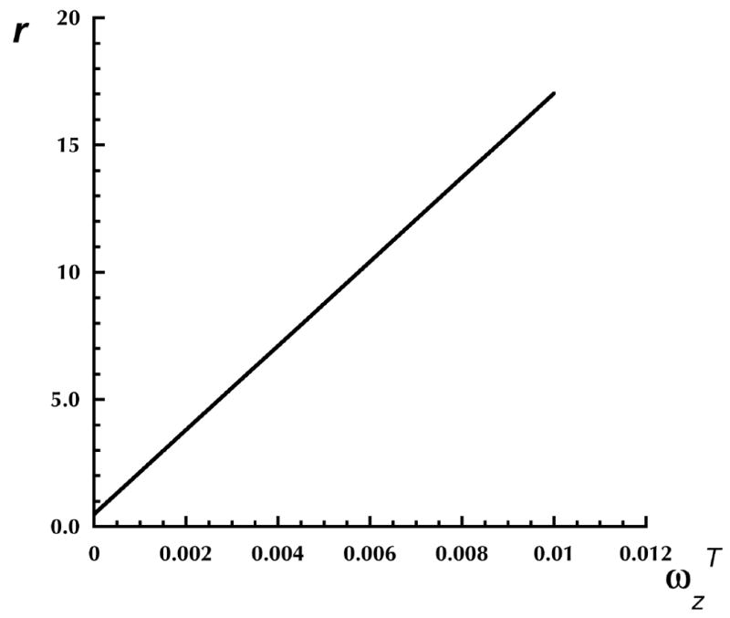

In 1781, Kant treated Euclidean space as a basic form of human experience. In modern terms, we seem to understand the world with an intrinsically straight ruler.

More than two centuries later, Julian Fernandez and Bart Farell asked a counterintuitive question. After the visual system combines multiple spatial cues, can that ruler remain straight? Their answer was that, in general, it cannot.

Their 2009 paper did not report a new behavioral experiment. Its central contribution was a mathematical result: when spatial quantities are estimated by familiar reliability-weighted cue integration, the combined percept will not generally preserve the Euclidean relations that each cue obeyed on its own. Special weights, single-cue judgments, and other integration rules remain possible exceptions.

## Is perceptual space Euclidean?

The claim that perceptual space is non-Euclidean predates this paper. The debate contains at least three distinct ideas.

First, perception can be distorted. Distant lengths may appear compressed, physical lines may look curved, and physically equal paths may not appear equal. But a distorted mapping from world to perception does not prove that the internal space is curved. A map can enlarge Greenland while remaining printed on flat paper.

Second, perception may not contain a stable metric at all. People can judge order, connectivity, and shape while remaining poor at absolute length and angle. Perhaps precise distance is not a primitive part of visual experience.

Third, perceptual space may possess a metric that is not exactly Euclidean. Luneburg modeled visual space with constant curvature, but later measurements suggested that estimated curvature changes with viewing distance.

Many behavioral findings can be explained by distorted input followed by an otherwise flat internal space. Fernandez and Farell therefore changed the question. Instead of adding another illusion, they asked what geometry follows from the cue-integration rule itself.

## Reliability and geometry impose different constraints

To estimate three-dimensional structure, vision combines binocular disparity, texture, motion, shading, and perspective. No cue is always reliable, so stable cues should count more than noisy ones. Under independent Gaussian noise, maximum-likelihood estimation gives each cue a weight proportional to its precision, the inverse of its variance.

Now consider two spatial quantities linked by a fixed relation. A circle, for example, has circumference (2\pi) times its radius. Suppose that every cue, considered separately, respects this relation. Will a reliability-weighted average also respect it?

The intuitive answer is yes, but different spatial quantities can have different noise. Radius may rely more heavily on one cue while circumference relies more heavily on another. Preserving the original geometry then requires those two sets of weights to coordinate exactly.

The key point is simple: **the weights that are statistically most reliable need not be the weights that are geometrically consistent.**

## From a Euclidean relation to a constraint on weights

Let two spatial quantities satisfy (x=g(y)). Cue M and cue S each provide estimates of both (x) and (y). The visual system combines the two estimates of (x) with one weight and the two estimates of (y) with another.

Write the two weighted estimates, require the combined result to satisfy (x=g(y)), and rearrange the equation. For every weight assigned to (y), Euclidean consistency permits only a specific weight for (x). The permissible pairs form a curve in weight space.

Maximum-likelihood integration, by contrast, chooses each weight from the variance of the corresponding cue estimate. It produces a point in the same weight space. The final percept is both statistically optimal and Euclidean only when that point lies on the geometric constraint curve.

The two constraints have independent origins. One comes from measurement uncertainty, the other from geometry. Without an additional mechanism that coordinates them, there is no reason to expect systematic coincidence.

The paper therefore argues that Euclidean structure will generally not survive cue integration. If judgments are internally consistent, admit a metric, and each cue separately recovers a Euclidean structure, a Riemannian space with nonzero curvature is a best-case description. The result does not prove that perception must form a Riemannian manifold.

## A circle for which pi is no longer pi

Suppose cue M estimates radius (hat r_M) and circumference (hat c_M), with (hat c_M=2\pihat r_M). Cue S also describes a valid circle. Radius and circumference may nevertheless have different cue reliabilities and therefore different integration weights.

In general, the combined estimates satisfy (hat c_{obs}\neq2\pihat r_{obs}). The perceived object still looks like a circle, but its circumference and radius do not obey the Euclidean relation. In the paper's compact notation, (pi_{obs}\neq\pi).

## Why curved perception need not look strange

A non-Euclidean tilted plane can still look like a tilted plane, and a non-Euclidean circle can still look like a circle. The discrepancy lies in relations among judgments, not necessarily in their immediate appearance.

This does not invalidate cue-integration experiments. Most measure one quantity, such as surface slant, and do not test whether several judgments jointly form a Euclidean space. A single estimate can be accurate even when the collection of estimates is geometrically inconsistent.

Nor is Riemannian geometry guaranteed. It requires mutually consistent judgments and a meaningful internal distance. If different tasks generate contradictory relations, perception may not support one unified geometry at all.

Relying on a single best cue would avoid conflicts among weights, but would discard information and contradict the broad evidence that observers combine multiple cues.

## Can the deviation be measured?

The paper's appendix estimates the effect for surface slant. An observer can infer slant from texture and binocular disparity, and can also judge the depth difference between two points. Euclidean geometry requires these judgments to agree.

Using parameters from Hillis and colleagues, the authors calculated a ratio (r) describing their consistency. Perfect Euclidean agreement requires (r=1).

Across most of the plausible weight range, combining texture and disparity moved (r) away from one. The predicted deviation was large enough to be accessible to psychophysical measurement. The paper did not conduct that experiment, but it specified what such a test should compare.

## What the argument changes

Optimal cue integration and Euclidean geometry solve different problems. The first tries to make each estimate as reliable as possible. The second requires different estimates to preserve fixed relations. Those goals can agree, but they need not.

The paper's contribution is therefore not another demonstration that perception is distorted. It shows how internally reasonable computations can create a collection of estimates that no longer belongs to one flat geometry. Radius, circumference, slant, and depth may each be estimated well while failing to compose a geometrically self-consistent world.

## Concepts needed to read the argument

- **Cue:** a source of spatial information, such as disparity, texture gradient, or motion parallax.
- **Maximum-likelihood estimation:** an estimator that weights independent Gaussian cues in proportion to their precision.
- **Precision:** inverse variance. A less variable cue receives more weight.
- **Intrinsic geometry:** relations among percepts, distinct from the mapping between the physical world and perception.
- **Riemannian space:** a geometry whose metric may vary across position. Euclidean space is the zero-curvature special case.
- **Monotonic relation:** one variable changes in only one direction as another increases. Special preserving weights may exist for monotonic relations, while some nonmonotonic cases admit none.

## References

Fernandez, J. M., & Farell, B. (2009). Is perceptual space inherently non-Euclidean? *Journal of Mathematical Psychology*, 53, 86-91.

Ernst, M. O., & Banks, M. S. (2002). Humans integrate visual and haptic information in a statistically optimal fashion. *Nature*, 415, 429-433.

Hillis, J. M., Watt, S. J., Landy, M. S., & Banks, M. S. (2004). Slant from texture and disparity cues: Optimal cue combination. *Journal of Vision*, 4, 967-992.

Koenderink, J. J., & van Doorn, A. J. (2000). Direct measurement of the curvature of visual space. *Perception*, 29, 69-79.
