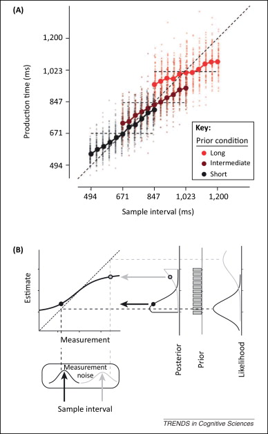
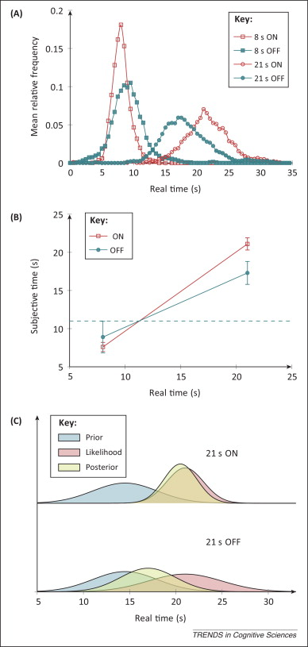
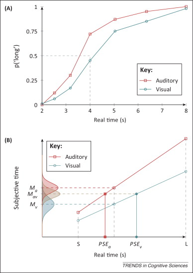
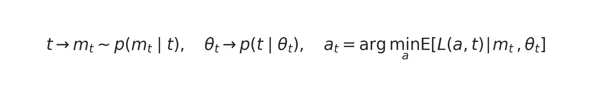

Suppose an experiment repeatedly presents intervals of different lengths and asks you to reproduce each one. After a few dozen trials, a stable pattern appears: short intervals are reproduced as too long, long intervals as too short, and responses drift toward the mean of the current set. Move the same physical interval into a longer context and it is reproduced as longer. Physical time has not changed. Its temporal context has.

These biases have been attributed to an inaccurate internal clock, memory decay, or the mixing of memory traces. In a 2013 *Trends in Cognitive Sciences* article, Zhuanghua Shi, Russell Church, and Warren Meck asked a different question. If every measurement of time is noisy, could using past experience reduce average error? Central tendency may not be a failure of the system. It may be calibration under uncertainty.

## Which phenomena need explaining?

The article is an Opinion piece that brings together several established paradigms rather than reporting one new experiment.

| Phenomenon | Typical task | Required judgment |
|---|---|---|
| Central tendency | Duration reproduction | Reproduce a previously presented interval |
| Modality effect | Temporal bisection | Classify an interval as closer to a short or long standard |
| Time-order error | Two-interval comparison | Decide which of two successive intervals was longer |
| Scalar property | Reproduction, production, or peak interval | Test whether variability grows proportionally with duration |

These paradigms measure interval judgments from hundreds of milliseconds to tens of seconds. They do not cover every experience described as the passage of time.

The Bayesian framework also does not replace process models of timing. Clock models describe how signals pass through a pacemaker, memory, and comparator. The Bayesian account asks how noisy evidence, previous experience, and task costs should be combined. The two descriptions operate at different levels.

## Vierordt's law and temporal context

In 1868, Karl von Vierordt described the pattern now called central tendency: shorter members of a duration set are overestimated and longer members underestimated. If an experiment presents 500, 700, 900, 1100, and 1300 ms, reproduction does not follow the identity line. It bends toward the center.

This is not simply keypress error. A 900 ms stimulus may appear relatively long in a 500 to 1000 ms context and relatively short in an 800 to 1300 ms context. The current stimulus is interpreted alongside the distribution of intervals that preceded it.

Adaptation-level theory summarizes previous stimuli as a background level. Scalar timing theory often places the bias in memory, where the current measurement mixes with stored temporal traces. Both accounts describe movement toward an average. A quantitative account must also explain when the observer should trust current evidence and when prior experience should dominate.

## Noisier measurements should depend more on experience

Let the true interval be (t) and the internal measurement be (m). A Gaussian approximation writes the likelihood as:

The measurement uncertainty is (sigma_m). The distribution of intervals experienced in the current environment supplies a prior (p(t)). Bayes' rule combines the two:

When likelihood and prior are Gaussian, the posterior mean becomes a weighted average:

Here (mu_p) is the mean of previously experienced intervals and (sigma_p^2) their variance. Reliable measurements push the weight (w) toward one. Noisy measurements pull the estimate toward (mu_p). Short intervals move upward, long intervals downward, and the attraction becomes stronger as sensory or memory uncertainty grows.

The prior need not be stored as an explicit probability table. It may arise from long-term reference memory, recent trials, or the statistics of the current block. Bayesian notation specifies how those sources influence an estimate. It does not identify the synapses or circuits that store them.

The data in this figure came from the reproduction experiment of Jazayeri and Shadlen. Each block sampled from a short, medium, or long distribution. The response curve bent toward the mean of its own block. The model explains the changing bias through the relative uncertainty of current measurement and contextual prior, rather than a fixed offset applied to every stimulus.

## Scalar variability and task loss

Timing variability usually increases with interval length. Across many tasks, response standard deviation is approximately proportional to target duration:

The constant (k) is a Weber fraction. Dividing response distributions by their means often makes them approximately overlap. The system preserves relative rather than absolute precision.

This matters for Bayesian estimation because long intervals have wider likelihoods and can be pulled more strongly by the same prior. The final response also depends on how the task values errors. If the task minimizes absolute squared error, the posterior mean is a natural action. If it penalizes relative error, a 100 ms mistake matters more at 500 ms than at 5 seconds. One possible relative loss is:

The posterior represents belief; the loss function determines which error is costly. Both are needed to predict behavior. This separation prevents every temporal bias from being redescribed as a faster or slower clock.

## Parkinson's disease and increased central tendency

The article uses a clinical example with 8 s and 21 s targets. When patients with Parkinson's disease were on dopaminergic medication, responses clustered near the trained targets. Off medication, 8 s responses shifted later and 21 s responses earlier. The two subjective intervals moved toward one another.

The Bayesian interpretation is not that the targets were forgotten. If current timing or memory becomes less precise, the observer increases reliance on background statistics. This can reduce average loss across the full task while sacrificing unbiased estimates at its extremes. The example illustrates how changing measurement precision alters the balance between evidence and prior; it does not imply that dopamine explains every central-tendency effect.

## Why sounds often seem longer than lights

In temporal bisection, participants learn short and long standards and classify intermediate stimuli. The interval producing 50 percent “long” responses is the point of subjective equality. Auditory intervals often reach this point at a shorter physical duration than visual intervals.

An internal-clock account may assign sound a faster pacemaker or a more reliable switch. A memory account may allow auditory and visual traces to mix. A Bayesian model expresses these proposals as differences in likelihood precision, prior memory, or decision boundary. This is useful because it reveals an identifiability problem. A single psychometric curve rarely distinguishes clock speed, switch noise, prior location, and decision loss. Training modality, context distribution, and feedback must be manipulated independently.

## Connecting clock, memory, and decision

| Processing stage | Classical timing account | Bayesian quantity | Question |
|---|---|---|---|
| Clock | Pacemaker, switch, accumulator | Likelihood (p(m\mid t)) | How precise is the current measurement? |
| Memory | Working and reference memory | Prior (p(t)) | Which durations usually occur? |
| Decision | Comparator and response rule | Loss (L(a,t)) | Which errors are most costly? |

This is not a fixed one-to-one neural mapping. Attention may change both switch behavior and decision policy; feedback may recalibrate a clock and update a prior. The value of the framework is to make the required quantities explicit before asking where and how the brain implements them.

A sequential extension makes the latent structure visible. True duration (t) produces a noisy measurement (m_t), an environmental state supplies prior parameters (	heta_t), and a task-specific loss produces action (a_t):

Clock slowing, prior drift, and conservative decisions can then make different predictions. Fitting only mean bias lets them imitate one another. Jointly fitting response means, variance, serial dependence, and adaptation to feedback offers a stronger test.

The practical lesson remains useful: whether a temporal illusion is rational cannot be judged from bias on a single stimulus. The relevant question is whether, under the observer's noise, stimulus distribution, and task costs, that bias lowers error across the environment.

## References

Shi, Z., Church, R. M., & Meck, W. H. (2013). Bayesian optimization of time perception. *Trends in Cognitive Sciences*, 17, 556-564.

Jazayeri, M., & Shadlen, M. N. (2010). Temporal context calibrates interval timing. *Nature Neuroscience*, 13, 1020-1026.
